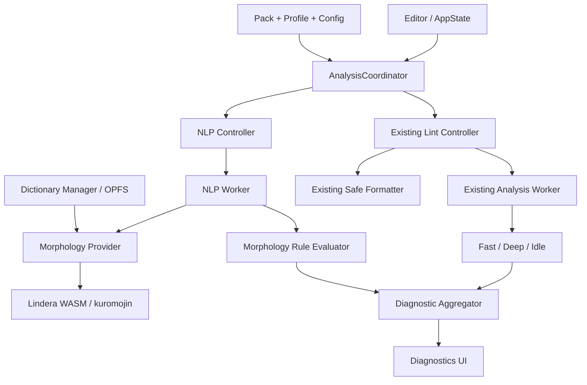
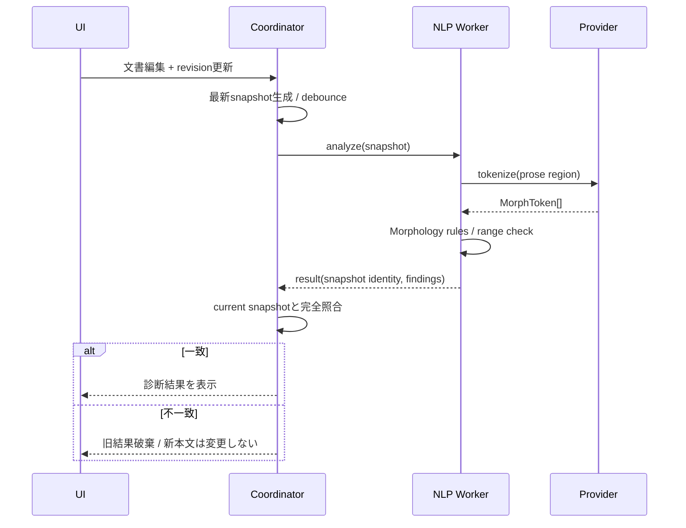
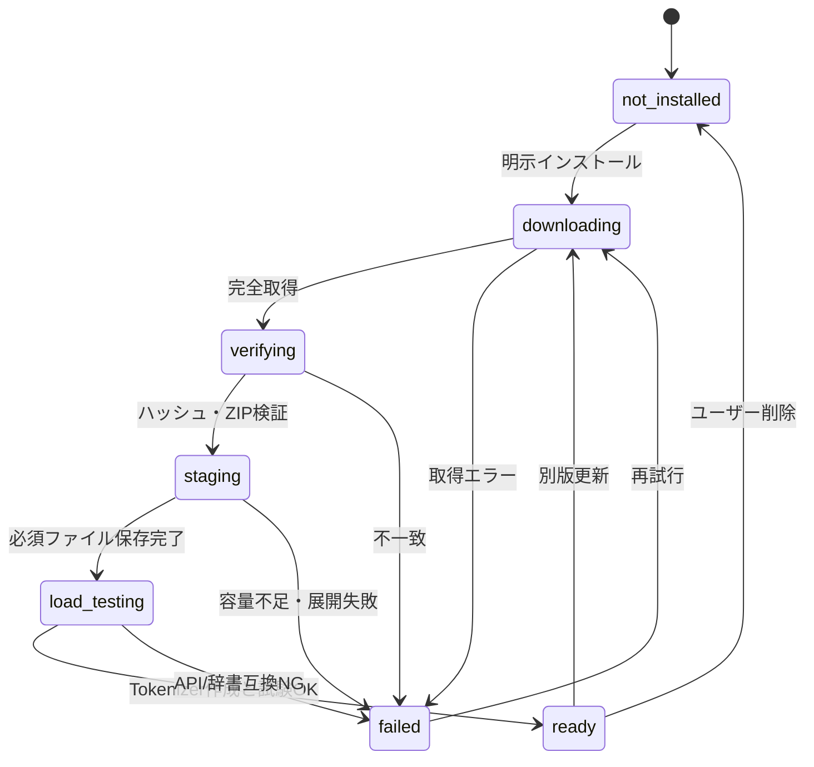
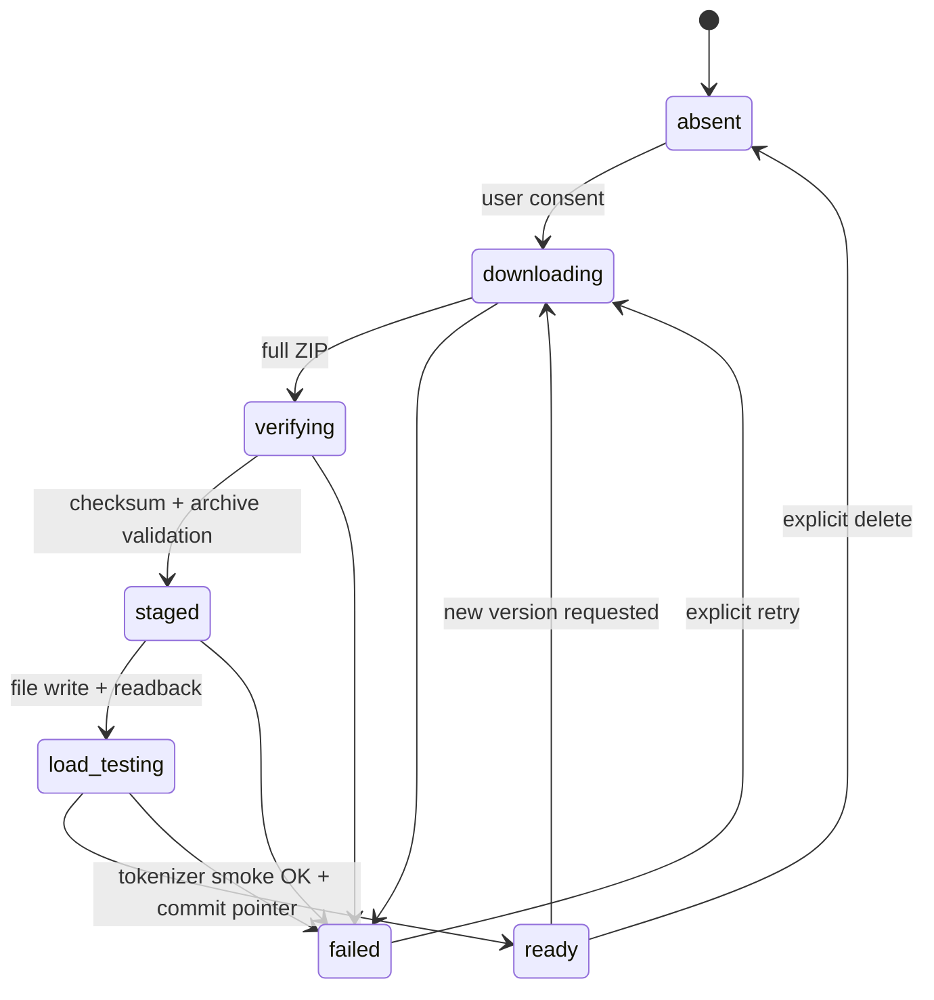
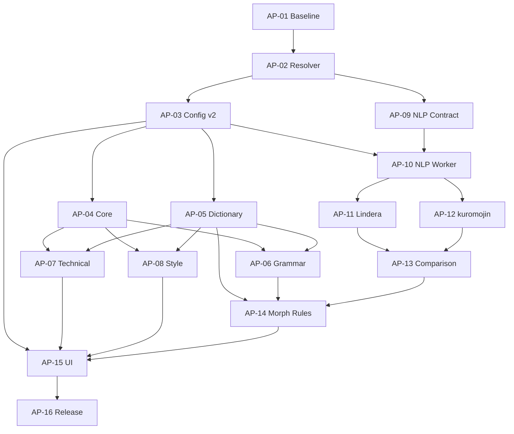

# Japanese Writing Toolkit — Analysis Packs × NLP 詳細設計書 v5.0

> **ステータス:** 実装前の設計・PoC仕様（実装・テスト実行・実測の完了を意味しない）  
> **計画レビューPR:** 本書をリポジトリへ追加するドキュメントPR。AP-01〜AP-16の機能実装・CI変更は含まない。
> **作成日:** 2026-10-23（JST）
> **v5基準コミット:** [`d4058cfc82ab24c8ab1f4a4a6b210f8c1d33d8ab`](https://github.com/Lamy210/japanese_text/commit/d4058cfc82ab24c8ab1f4a4a6b210f8c1d33d8ab)（現行確認済main）。
> **追加仕様:** Part II（v5規範仕様・参照実装・テストID・全PRのDoD）を収録。Part Iとの齟齬はPart IIを優先。  
> **対象:** [`Lamy210/japanese_text`](https://github.com/Lamy210/japanese_text) / `main`  
> **確認時点の基準コミット:** [`d4058cfc82ab24c8ab1f4a4a6b210f8c1d33d8ab`](https://github.com/Lamy210/japanese_text/commit/d4058cfc82ab24c8ab1f4a4a6b210f8c1d33d8ab)（PR #51、2026-10-23 JST）  
> **入力資料:** 「Japanese Writing Toolkit — Analysis Packs Implementation Plan」（v1、基準 `b95e2dd`）／統合設計 v3.0／本会話のライブラリ・技術調査  
> **実装単位:** 仮PR番号 `AP-01`〜`AP-16`。既存GitHub PR番号と無関係。  
> **設計原則:** ブラウザ完結・文章の外部送信なし・LLM不要・既存の3-tier解析とSafe Formatterの契約を維持。

---

## 目次

- **Part I:** v4由来の要件・機能・PoC設計（第0〜20章・付録）
- **Part II:** v5新規の実装仕様（第21〜39章）：Resolver、Migration、Worker、Offset、Markdown、辞書、OSS Adapter、各Pack Rule、テストID、16 PRのDoD、Runbook

- 0〜3：事実確認・設計原則・6 Packの責務
- 4〜5：アーキテクチャ・モジュール配置・TypeScript契約
- 6〜7：設定移行・Private Session・Worker通信
- 8〜9：Unicode位置・Markdown抽出・辞書・ルール
- 10〜12：Lindera/kuromojin・導入OSS・形態素校正
- 13〜16：診断UI・性能・セキュリティ・Gold・テスト
- 17〜18：16 PRの実装順序・リリース・ロールバック
- 19〜20／付録：未確定事項・一次資料・導入候補コマンド

---

## 0. 読み方と事実の確度

本書中の記載を次の3つに区別する。

- **[確認済み]**: `japanese_text` のソースまたはOSS一次資料で確認した振る舞い。バージョンや日付を伴うものは確認時点に限定。
- **[設計決定]**: 今回採用する仕様。まだ実装されていない。
- **[仮説／PoC]**: ブラウザ互換性、辞書再配布、実行速度、正確性など、実機検証に依存する事項。

**禁止する推論:** 「npmに公開されている」→「ブラウザWorkerで動く」、「形態素解析できる」→「文法誤りを正しく検出できる」、「合成コーパスで100%」→「実文章でも100%」とみなさない。

### 0.1 変更履歴

| バージョン | 主な変更 |
|---|---|
| v1（添付資料） | 6つのAnalysis Pack、Providerレジストリ、12 PR案 |
| v3（前回設計） | Pack/Provider/Ruleの分離、NLP専用Worker、16 PR案、Private境界 |
| v4 | API型、状態遷移、設定射影、辞書配布・整合性、オフセットアルゴリズム、全16 PRのファイルとテスト、比較評価とGo/No-Go、採用OSSの実装上の制約を明文化 |
| **v5（本書）** | Pack Resolverの規範仕様、Config/Worker/Diagnosticsの厳密な契約、バイト位置写像の参考実装、辞書の障害復旧、OSS Adapter、Rule・テストID、全16 PRの開発DoDを追加 |

## 1. 背景・現状・到達目標

### 1.1 現行実装の棚卸し [確認済み]

- 技術スタックは SolidJS / TypeScript / CodeMirror 6 / Vite / Bun。基本的にGitHub Pagesを含む静的配信を想定。
- `src/core/types.ts` は `RuleTier = 'fast'|'deep'|'idle'`、`DiagnosticSource = 'core'|'textlint'|'user'`、`CoreRule.run()` は**同期**、位置はUTF-16 `[start,end)`。
- `src/core/engine/engine.ts` は同一リクエストのマスク・行索引・ルールレジストリを共有する。`RuleProvider` はローカルの同期ルールを登録。
- `src/worker/analysis.worker.ts` はRevisionゲートとTextlintの遅延読み込みを持つ。
- `src/state/lint-controller.ts` は既存Fast 100ms、Deep 250ms、Idle callback、Worker監視10秒、復旧制御を持つ。
- `src/core/formatter/lint-safety.ts` は**Fast/Deep/Idleがすべて正常完了した場合のみ**安全確認し、失敗・欠落・Revision不一致ではfail-closed。
- `src/core/text/mask.ts` はMarkdownの非文章領域をU+FFFFで置換し**UTF-16長を維持**。UTF-8バイト長は元文と一致しない。
- `src/core/text/segmenter.ts` は `splitSentences()` が事前初期化されていない場合、`Intl.Segmenter` 対応ブラウザでもfallbackになる可能性がある。これはソースから推定した潜在的欠陥であり、修正前に再現テストを要求。
- `AppConfig` は schema v1。`RuleProfile` の `rules` / `ngWords` / `terminology` 等と、`GlobalPreferences` / `Workspace` の値を `src/storage/compat/app-config-projection.ts` で合成・分解する。
- IndexedDBは `src/storage/db/schema.ts` でバージョン2。**Config v2とIndexedDB v3は同義ではない。**
- 既存校正には誤表記、用語、助詞、二重敬語、文体、冗長、文書構造などがすでに存在。**同機能の二重追加をしない。**
- `package.json` の既存Textlint動的ルールは `sentence-length`、`no-nfd`、`no-hankaku-kana`。Lindera/kuromojinは未導入（基準main）。
- `tests/corpus`、`tests/performance`、`dev/benchmark.html`に既存回帰・計測基盤があるが、実文章での品質証明ではない。

### 1.2 目的 [設計決定]

1. 従来の規則ベース校正に加え、**形態素・語彙・文法・技術文書・文章スタイル**の解析力を増やす。
2. 新ルール・辞書・Providerの独立配布と比較を可能にする。
3. 誤検知率、文字範囲、根拠説明、プライバシーの品質契約を明文化する。
4. 追加機能は段階的に提供し、NLPが失敗しても従来機能が動く。
5. Lindera WASM・kuromojinを**最終的な校正品質**と保守・性能で比較し、採用を決める。

### 1.3 非対象

- リモートLLM、クラウド推論サーバー、Pythonサーバーの本番稼働。
- 文章の意味、事実関係、主述係り受けを形態素情報だけで保証すること。
- 自動でユーザー本文や辞書を第三者へ送ること。
- 未監査のサードパーティJSをユーザー定義Providerとして実行すること。
- 既存全文を自動変換する危険なFormatter変更。
- 新しいCIワークフローの導入。本計画は既存のローカル検証／既存CIを利用する。

## 2. 絶対不変条件とアーキテクチャ決定

| ID | 仕様 | 検証責任 |
|---|---|---|
| INV-01 | NLP無効の既存3-tier診断とFormatterは基準goldと同等（個別バグ修正は差分記録） | AP-01 / AP-16 |
| INV-02 | NLP未導入・失敗・タイムアウト時もEditor・既存校正は継続 | AP-10 / 16 |
| INV-03 | 診断位置は元文UTF-16 `[start,end)`、範囲外・サロゲート分断は禁止 | AP-09 |
| INV-04 | Document/Workspace/Profile/Revision/Config/Provider/Dictionaryのスナップショットを混在させない | AP-10 |
| INV-05 | NLP診断の `fixKind` は `none` または `suggestion` のみ。PoCで`safe`禁止 | AP-14 |
| INV-06 | ユーザー本文・トークン・私用辞書はサーバ送信せず、無断永続化しない | 全PR |
| INV-07 | 辞書・解析器・ルールデータの版、整合性、ライセンスを追跡可能 | AP-05 / 11 / 12 |
| INV-08 | `RuleTier`は3種のまま維持。Formatterの完全Baseline/Shadow確認は変更しない | AP-10 / 16 |
| INV-09 | `disabled`/`not-installed`/`running`/`failed`/`complete-no-issues`を識別 | AP-10 / 15 |
| INV-10 | 同一入力・同一スナップショット・同一辞書で決定論的な結果と順序 | 全PR |
| INV-11 | Pack/Profile切替はテキスト・個人辞書・ストレージ許可を暗黙に移動しない | AP-03 / 05 / 16 |
| INV-12 | 初期アプリバンドルはWASM・巨大辞書を含めない | AP-11 / 16 |

**ADR-001:** NLPは独立Workerを採用。既存Workerと共存し、別の状態・タイムアウト・キャンセル管理を持つ。  
**ADR-002:** PackはUIと設定の機能分類。Providerは実行可能性、Ruleは診断単位、Dictionaryはデータソース、Presetは初期設定、Profileは保存される選択状態。  
**ADR-003:** 初回のNLP有効化・辞書取得は明示操作による。暗黙の外部ネットワーク取得禁止。  
**ADR-004:** 新規ルールは必要以上に既存ルールIDを変更しない。重複はShadow比較から段階統合。  
**ADR-005:** 形態素・辞書に起因する自動修正はPoCでは全面禁止。  
**ADR-006:** 小型の一般校正ルールは先行リリース可能。Linderaの採用判断に依存しない。

## 3. 6 Analysis Packs仕様

### 3.1 データ所有権と実行条件

| Pack | ID | 機能 | 既定 | Provider要求 | 初期の追加候補 |
|---|---|---|---|---|---|
| 基本校正 | `core` | 字種・句読点・Markdownなど既存基盤 | 常時ON | builtin / textlint | 制御文字、ゼロ幅スペース、文分割修正 |
| 日本語文法 | `grammar` | 助詞・ら抜き・二重否定・活用・敬語 | 軽量ルールのみ | builtin; kuromojin等はoptional | no-double-negative-ja、no-dropping-the-ra |
| 辞書強化 | `dictionary` | 誤字・表記統一・固有名詞・同義語 | 軽量ルールON | builtin/dictionary | prh変換、辞書内spec、誤用エントリ |
| 形態素 | `morphology` | tokenization、POS/lemma/readingの提供 | **OFF** | lindera / kuromojin | Adapter、OPFS、比較ベンチ |
| 技術文書 | `technical` | README/仕様書/API/Markdown | プリセット依存 | builtin / 個別textlint | unnatural-alphabet、mixed-period等 |
| 文章スタイル | `style` | 接続詞、反復、読みやすさ、文章構成 | 安全なルールON | builtin / 個別textlint | weak-phrase、スタイル参考ルール |

**重要:** `morphology`は解析能力を供給するPackで、他のPackの「全ルールの親」ではない。例えば助詞誤用のRule所有者は`grammar`、その必要Capabilityが`pos`等となる。`morphology` OFFでも`grammar`の軽量ルールは実行される。

### 3.2 Pack / Rule / Providerの解決規則

```text
packEnabled(rule.primaryPack)
 AND ruleEnabled(ruleId)
 AND providerState IN {'ready','builtin-ready'}
 AND all(requiredCapabilities are supported)
 AND docType in rule.supportedDocumentTypes
 AND dictionaryScopeAllows(rule, activeProfile)
 => execute
otherwise => skip with structured reason, never silently claim zero errors
```

- `core.enabled`は設定Import時も常にtrueに正規化する。値falseはバリデーションエラーまたは明示的な補正対象。
- **既存Ruleの移行:** v1のRule Profileが表す有効Ruleは、そのままv2で有効にする。現行ルールをPackタグ付けする際は、初回移行ですべての所有Packを必要に応じONとし、Rule ID / 有効設定を保存する。一般・技術の旧診断が変わる場合は互換性違反として修正する。
- v2でユーザーがPackをOFFにした場合は配下Ruleを実行しない。ただし設定済みルール情報は残し、再度ONで復元する。
- 新規の低信頼度RuleはPackがONでも個別RuleをデフォルトOFFにする。`strict`でもNLPヒューリスティックを即Errorへしない。
- Providerの準備完了は辞書の存在確認だけでなく、互換性・ロード成功を要求する。
- Provider循環依存、重複ID、実行不可capability、任意実行形式のManifestは登録拒否。

### 3.3 既存Ruleとのマッピング

初期実装では現行Rule IDを維持したまま、メタデータ層に**primaryPack / tags**だけ付与する。

| 主な既存ルール | Packの主所属 | 注意 |
|---|---|---|
| `typography/*`, `markdown/*`, `reference/*` | `core` | インフラ基礎。将来technicalにも表示上のtagを付けられる |
| `wording/common-typo`, `wording/terminology`, `wording/ng-word` | `dictionary` | `source='user'`の現行契約を維持 |
| `wording/double-honorific`, `wording/doubled-object-particle`, `wording/honorific-request` | `grammar` | NLP版との重複要検証 |
| `style/mixed-tone`, `style/cross-paragraph-tone` | `grammar`または`style` | 所属はAP-02で一意確定。既存IDは変更しない |
| `wording/redundancy`, `wording/repeated-phrase`, 文書構成系 | `style` | 既存の検出動作を優先 |
| 技術語・Markdown関係の今後の追加Rule | `technical` | 既存基礎Ruleを物理的に複製しない |

**対応表は単独の静的Manifestから生成し、各Packに別々にRule実装を複製しない。** 所属の曖昧な既存ルールはAP-02のgold reviewで決める。

## 4. 技術構成とコード配置

### 4.1 構成図



既存FormatterへNLPは接続しない。診断表示統合と自動整形は異なる実行経路。

### 4.2 提案ファイル構成

```text
src/
  core/
    analysis/
      packs.ts                 # Packマニフェスト・所有Rule対応
      provider-manifest.ts     # 非同期Providerメタデータ
      provider-registry.ts     # 固定・検証済みProviderの登録
      resolver.ts              # Pack / Rule / Capability解決
      diagnostic-aggregator.ts# 診断の正規化・重複処理
      provenance.ts            # 診断根拠
    dictionary/
      schema.ts                # 辞書v1契約
      loader.ts                # ビルド済みJSON/Import辞書のロード
      validator.ts             # サイズ/件数/ID/参照検証
      precedence.ts            # ユーザー許可/分野/組込の優先順位
      compiler.ts              # 文字列パターン照合（必要ならAC）
      rule-evaluator.ts        # 辞書診断、修正候補
    nlp/
      types.ts                 # Token/Sentence/Context/Capabilities
      tokenizer.ts             # MorphologyProviderインターフェース
      offset-map.ts            # byte/code-point → UTF-16
      prose-regions.ts         # Markdown文章領域の抽出
      pos-normalization.ts     # 品詞の正規化
      token-validator.ts       # 区間・表層形検証
      morphology-rules.ts      # NLPの文脈Rule
      providers/
        lindera.ts
        kuromojin.ts
      dictionary-manager.ts    # OPFSにおける辞書版管理
  worker/
    nlp-protocol.ts
    nlp.worker.ts
  state/
    nlp-controller.ts
    nlp-state.ts
  storage/
    nlp-asset-manifest.ts     # 利用可能な辞書版、同意と状態
  components/
    AnalysisPacksPanel.tsx
    NlpDictionaryManager.tsx
    NlpDiagnosticEvidence.tsx
scripts/
  validate-dictionaries.ts    # 入力辞書のビルド時検査
  benchmark-nlp.ts            # Node側の参考値（ブラウザ基準とは分離）
dev/
  nlp-benchmark.html          # ブラウザ専用。実文書と分離
tests/
  analysis/                   # Pack/Provider/Aggregator
  dictionary/                 # 辞書・優先順位・安全性
  nlp/                        # Unicode/Adapter/Worker/異常系
  corpus/                     # Goldデータ（独立Holdoutを含む）
  performance/nlp/            # 比較スクリプト
assets/
  dictionaries/               # 軽量辞書。巨大辞書はここに直コミットしない
```

ファイル名は提案。`src/core`はUIやStorage依存を持たず、ブラウザAPIを使う永続辞書管理は`src/storage`または`src/worker`側に分離する。上の`core/nlp/dictionary-manager.ts`は抽象インターフェースとし、OPFS具象実装は`storage`配下に置く。

### 4.3 依存方向

`UI → Controller → Worker → Engine/Adapters → Dictionaries`。`core` から `SolidJS`, `CodeMirror`, `IndexedDB`, `navigator`への直接依存禁止。循環import検出をローカル静的検査の対象とする。`textlint` は既存の動的Adapterで独立ロードし、巨大辞書のimport時に初期バンドルを増やさない。

## 5. TypeScript契約：Pack・Provider・Rule

下記は**規範的な設計用サンプル**であり、現mainに存在する実装ではない。

```ts
export type PackId =
  | 'core' | 'grammar' | 'dictionary' | 'morphology' | 'technical' | 'style';

export type Capability =
  | 'sentence' | 'word-boundary' | 'tokenize' | 'pos' | 'lemma'
  | 'reading' | 'conjugation' | 'unknown-word' | 'normalized-form';

export type ProviderKind = 'builtin' | 'textlint' | 'dictionary' | 'morphology';
export type ExecutionMode = 'sync' | 'async-worker';

export interface AnalysisProviderManifest {
  id: string;                   // ローカルで登録する固定ID
  version: string;              // パッケージに固定した版
  kind: ProviderKind;
  executionMode: ExecutionMode;
  capabilities: readonly Capability[];
  assetIds: readonly string[];  // 依存辞書 / WASM
  licenses: readonly string[];
  supportedDocTypes: readonly ('markdown' | 'text')[];
  networkPolicy: 'no-network' | 'explicit-asset-download';
}

export interface AnalysisRuleManifest {
  id: string;                   // 既存 Rule IDは変更禁止
  primaryPack: PackId;
  providerId: string;
  category: string;             // 既存RuleCategoryにマップ
  requiredCapabilities: readonly Capability[];
  docTypes: readonly ('markdown' | 'text')[];
  defaultEnabled: boolean;
  defaultSeverity: 'info' | 'warning' | 'error';
  fixPolicy: 'none' | 'suggestion' | 'safe';
  issueFamily?: string;         // 明示的な重複統合用
}

export type RuleEligibility =
  | { kind: 'runnable'; providerId: string }
  | { kind: 'skipped'; reason:
      'pack-disabled' | 'rule-disabled' | 'provider-not-ready'
      | 'missing-capability' | 'missing-dictionary'
      | 'unsupported-document-type' | 'policy-blocked' };
```

- Registryの登録は静的・純粋なデータ処理に限定し、登録時に任意のNetwork/WASM/ファイル読み込みを実行させない。
- Manifestの`fixPolicy`に違反するRule出力はAggregatorで拒否する（例: NLP Providerが`safe`を返したらエラー）。
- 不足CapabilityはRule単位のskippedイベントとし、Pack全体の0件診断とはしない。
- エラー文・根拠文はプレーンテキストとして描画。HTMLやJSは実行しない。

## 6. Config v2／RuleProfile／Workspace／IDB

### 6.1 v2 AppConfig案

```ts
export interface AnalysisPacksConfig {
  core: true;
  grammar: boolean;
  dictionary: boolean;
  morphology: boolean;
  technical: boolean;
  style: boolean;
}

export interface NlpConfig {
  enabled: boolean;              // 明示ONのみ
  providerId: 'lindera' | 'kuromojin';
  dictionaryId?: string;          // 検証済みassetManifest内のID
  automaticMaxUtf16: number;      // 初期案 10_000、上限に検証
  manualMaxUtf16: number;         // 初期案 50_000、上限に検証
  showEvidence: boolean;
}

export interface AppConfigV2 extends Omit<ExistingAppConfigV1, 'schemaVersion'> {
  schemaVersion: 2;
  analysisPacks: AnalysisPacksConfig;
  nlp: NlpConfig;
  // 既存: rules, ngWords, terminology, citation, formatter, editor, privacy, theme は維持
}
```

ここでの`ExistingAppConfigV1`は説明用の型名であり、`Omit`によりv1のschemaVersionを除いてv2を定義している。実装では現行`AppConfig`を破壊的に置換しない。移行関数の入出力型を明確に分ける。

### 6.2 データの所有・永続化境界

| レイヤー | 所有情報 | 書込み先 | プライバシー条件 |
|---|---|---|---|
| GlobalPreferences | テーマ、エディタ、利用規約・資産取得に関する非機密設定 | 既存Preferences | profile移動でも失わない。保存同意と使用同意は別 |
| RuleProfile | Pack選択、NLP選択、Rule有効・Severity、共有可能な辞書の**参照ID** | 既存RuleProfile | 個人用の辞書本文を無条件に埋め込まない |
| Workspace | 選択Profile、storageMode、辞書利用スコープ | 既存Workspace | Workspace削除に連動する参照を消す |
| Session | Private本文、Private辞書、未確定編集、Token、Workerインスタンス | メモリのみ | Privateからの移行で自動保存禁止 |
| Shared Asset | 公開辞書ZIP・検証版メタデータ | OPFS＋必要最低限のmanifest | 個人データを含まない。全Profileで共有可 |
| User Dictionary | 非公開語彙、用語例外 | 明示保存時のみIDB | 認可されたWorkspace/Profileに紐付ける |
| Document Suppression | 現行の警告無視 | 既存の保存ルール | `source/ruleId/excerpt`キーとの互換を保つ |

**重要なコード変更:** `src/storage/compat/app-config-projection.ts` の`composeAppConfig()`と`splitCommon()`両方を同じPRで更新。`src/core/workspace/types.ts`の`RuleProfile`、`src/core/workspace/defaults.ts`、`src/core/workspace/validate.ts`、`src/storage/compat/app-config-projection.ts`、`src/core/config/validate.ts`を横断的に変更する。Profile複製・切替・Workspace切替・削除後の正確な復元をテスト。

### 6.3 マイグレーション契約

1. Config v1入力をデータとして検証。既存Rule設定と用語を保持。
2. `analysisPacks.core = true`、`morphology = false`とする。v1で有効だったRuleを持つ各PackはONにして**旧結果を維持**。新規ヒューリスティックRuleはOFFで初期化。
3. `nlp.enabled = false` とし、辞書ダウンロードは開始しない。
4. 未知の属性は既存と同じ扱いで無視・拒否を一貫化。**将来のschemaVersionは拒否**し、ユーザーデータを勝手に変換しない。
5. `compose(split(config))` がPack / Rule / 辞書参照・同意情報を適切に復元する。保存モード変更は通常の`saveConfig`から発生させない。
6. IndexedDB v2のレコード拡張だけで実現できるならDB_VERSIONを増やさない。新しいUserDictionary Storeが必要ならv3変更を独立PRとして扱う。
7. 既存のv1互換Exportを残す場合はNLP設定を明示的に除外した**別機能**とし、v2→v1の勝手なダウングレード禁止。

**入力検証の追加項目:** 解析対象長を数値・整数・上限でクランプ、`providerId`の許可リスト、辞書参照IDの形式検証、Packキーのホワイトリスト、誤った重複ID・未知Providerは安全な無効状態へ。巨大な辞書文字列を設定JSON本体へ混ぜない。

### 6.4 スキーマテスト

`v1 → v2 → v2 serialize/deserialize`、旧General/Technical/Strict/Minimal、複製Profile、未保存Private辞書、Workspace削除後の参照清掃、`onblocked`/`versionchange`でのIDB互換、StorageModeの予期せぬ変更ゼロ。重要: migration失敗を自動で初期化とみなさず、バックアップや復旧導線を提供。

## 7. 非同期解析プロトコルとスナップショット

### 7.1 Snapshot

```ts
export interface NlpAnalysisSnapshot {
  protocolVersion: 1;
  requestId: string;             // インスタンス内一意
  documentInstanceId: string;    // 文書開閉ごとに変わるID
  workspaceId: string | null;
  profileId: string | null;
  revision: number;
  configEpoch: number;
  workerEpoch: number;
  providerId: 'lindera' | 'kuromojin';
  providerVersion: string;
  dictionaryDigest: string;
  docType: 'markdown' | 'text';
  text: string;                  // 伝送先は同一オリジンのWorkerのみ
  regions: readonly ProseRegion[];
}
```

**Snapshot identity:** `documentInstanceId + workspaceId + profileId + revision + configEpoch + workerEpoch + providerVersion + dictionaryDigest + requestId` の完全一致。`text`や本文ハッシュをメトリクスに保存しない。`revision`だけでは別文書切替を判別できない。

### 7.2 メッセージ（終端性）

```ts
type NlpWorkerRequest =
  | { type: 'initialize'; operationId: string; providerId: string; dictionaryId: string }
  | { type: 'analyze'; snapshot: NlpAnalysisSnapshot }
  | { type: 'cancel'; requestId: string }
  | { type: 'dispose'; operationId: string };

type NlpWorkerResponse =
  | { type: 'ready'; operationId: string; workerEpoch: number; capabilities: Capability[] }
  | { type: 'progress'; operationId: string; phase: string; processed: number; total?: number }
  | { type: 'result'; requestId: string; snapshotKey: string; findings: NlpFinding[]; durationMs: number }
  | { type: 'skipped'; requestId: string; reason: 'superseded' | 'cancelled' | 'unsupported' }
  | { type: 'failed'; requestId: string; code: NlpErrorCode; recoverable: boolean };
```

`NlpErrorCode`: `ASSET_MISSING`, `ASSET_CORRUPT`, `UNSUPPORTED_BROWSER`, `STORAGE_QUOTA`, `INITIALIZE_FAILED`, `OFFSET_INVALID`, `TIMEOUT`, `CANCELLED`, `CONTRACT_VIOLATION`（必要に応じ増補）。

**終端規則:** analyzeごとに`result`/`skipped`/`failed`のいずれか**1つだけ**。Workerが異常終了した場合はCoordinatorが「失敗」として待機Promiseを解決してからWorkerを交換。重複完了・旧Worker通知は破棄する。`initialize`の要求はoperationIdで別の完了管理を行い、文書revisionと混ぜない。

### 7.3 実行順序



- 既存Lintと別の`NlpController`がdebounce・watchdog・ステータスを保持する。
- 同一Worker内では同時`tokenize`を基本1件とし、**未開始の中間Revisionは破棄、最新のみ保持**。
- WASM内の同期処理を即時中断できるとはみなさない。文単位・region単位の仕事の間でキャンセル確認。ハング時は専用WorkerごとTerminateし、新Epochへ。
- `Worker.postMessage`のstructured clone負荷とメモリ二重化をベンチ対象とする。PoCでは全文章を渡せるが、長文はregion単位の範囲指定を検討。
- Shadow Formatterの負Revisionは既存Worker専用。NLPに渡さない。

### 7.4 段階的スケジューリング（暫定）

| 文書のUTF-16長 | 既定 | NLPで行うこと |
|---:|---|---|
| 0〜1,000 | 明示ON時はidle/debounce | 初期化完了後に全regionを解析 |
| 1,001〜10,000 | 明示ON時はdebounce | 最新Revisionのみ |
| 10,001〜50,000 | 手動解析を推奨 | 分割処理・上限とキャンセルを表示 |
| 50,001〜100,000 | ベンチ専用 | UI自動実行は禁止 |
| 100,000超 | 今回対象外 | 既存校正だけ実行 |

閾値は性能試験で変更できる**設定値の初期案**であり、測定済SLOではない。キーストロークごとにWASMを初期化することは禁止。

## 8. 原文位置・Unicode・Markdown文章領域

### 8.1 MorphToken契約

```ts
export interface MorphToken {
  surface: string;
  lemma: string | null;
  reading: string | null;
  pos: 'noun' | 'verb' | 'adjective' | 'particle' |
       'auxiliary' | 'adverb' | 'conjunction' | 'symbol' | 'other';
  posDetails: readonly string[];
  conjugationType: string | null;
  conjugationForm: string | null;
  isUnknown: boolean | null;
  startUtf16: number;          // 元文中の絶対位置
  endUtf16: number;            // 元文中の排他終了位置
  regionId: string;
  sentenceId: string;
  originalFeatures: readonly string[];
}

export interface ProseRegion {
  id: string;
  sourceStartUtf16: number;
  sourceEndUtf16: number;
  kind: 'paragraph' | 'heading' | 'list' | 'link-label' | 'table-cell' | 'quote';
  text: string;               // text === source.slice(sourceStart, sourceEnd)
}
```

全トークンに `0 <= start < end <= source.length` と `source.slice(start,end)===surface` を要求。規格外tokenを診断計算へ渡さない。未知の品詞細分類や辞書欠落は推測で補完しない。`isUnknown`が取得できないProviderでは`null`とする。

### 8.2 Lindera WASM：UTF-8バイト→UTF-16

Lindera v6.2.0のWASM APIはJSプレーンオブジェクトで`surface`/`byteStart`/`byteEnd`/`position`/`wordId`/`isUnknown`/`details`を返す。`byteStart/byteEnd`は**入力regionテキストをUTF-8へ符号化した時の相対位置**。辞書によって`details[]`の並びは異なるためIPADICごとにAdapterでパースする。([公式実装](https://github.com/lindera/lindera/blob/v6.2.0/lindera-wasm/src/token.rs))。

**アルゴリズム:**

1. 原文 `source` から確定済み`region.text`を得る。本文全体をmask文字に置き換えた文字列は使用しない。
2. `for...of`でコードポイント単位に走査し、`TextEncoder`によるUTF-8幅とJS文字列のUTF-16幅を累積。単調増加する`byteOffset → utf16Offset`境界配列を作成する。
3. `byteStart`/`byteEnd`を**境界完全一致**で引く（途中のUTF-8バイトは拒否）。regionの`sourceStartUtf16`を加算する。
4. Unicode不正サロゲートを検出したregionはPoCではスキップする。`TextEncoder`の代替文字変換で原文の表層一致が壊れるため。
5. `source.slice(start,end) === token.surface`を検証。区間の重なり・範囲外も拒否。
6. Unicode正規化（NFC/NFKC）による形態素解析器内の変化は勝手に元文位置へ比例配分しない。元文との厳密対応が取れない場合はスキップ。

**サンプル:** `A😀日本語B`：UTF-16位置`A=0, 😀=1, 日=3, 本=4, 語=5, B=6`、UTF-8バイト位置`A=0, 😀=1, 日=5, 本=8, 語=11, B=14`。ASCII＋絵文字が混在した場合に数字が異なる。

### 8.3 kuromojin：word_position変換

[kuromojin](https://github.com/azu/kuromojin) のtokenは`word_position`, `surface_form`, `pos`, `pos_detail_*`, `conjugated_type`, `conjugated_form`, `basic_form`, `reading`, `word_type`等を返す。`word_position`の起点（通常1-originとみなされるがPoCで検証）とUnicode挙動を独立Goldテストで確定する。位置の累積探索などのfallbackも、**原文の同じ表層形を誤って拾わない**ことを条件とする。

### 8.4 Markdown ProseRegionExtractor

- 入力は**原文**。Markdown構文の位置と種類を元のUTF-16オフセットで解析する。
- 優先的に既存CodeMirror/LezerのMarkdown構文データを利用可能か調査する。Workerで使う場合は必要パッケージを**明示依存**し、解析結果の位置が元文に対応することを検証する。`maskDocument()`は回帰テスト・補助除外として再利用。
- Code Fence・Inline Code・リンクURL・裸URL・HTMLコメント・frontmatter・参照定義は完全に除外。
- 段落、見出し表示テキスト、リスト本文、リンク表示テキストは対象。Markdown表の自然文セルは後段。引用はPoC既定OFF（設定変更時の誤検知テスト後に対応）。
- 書式文字列`**...**`などの不連続spanは各連続区間を独立処理し、**隙間を跨ぐ文法診断をPoCでは出さない**。リンク表示テキストがregion内で部分文字列でも位置は正確に保持する。
- CRLF正規化の適用地点を決める。現行`RuleContext.text`は`\n`正規化済みと記載されているが、Providerへ渡す文はEditor側で表示している同一の正規化済テキストを使用し、正規化前ファイル位置と混同しない。
- Markdown構文解析に失敗した場合は、全部を文章扱いせず安全側へfallback。抽出不能範囲は報告しない。

**Goldテスト:** コード・リンク・テーブル・未閉鎖Fence・ネストリスト・引用・Emoji/ZWJ・半角カナ・異体字セレクタ・結合文字・重複サーフェス・空文章・孤立サロゲート・改行位置。

## 9. 辞書・ルールエンジンの詳細

### 9.1 辞書種別

| Dictionary ID例 | 主Pack | 内容 |
|---|---|---|
| `ja-typos` | dictionary | 既存8件の誤表記を移行、正例/負例・固有名詞除外 |
| `ja-terminology` | dictionary | 推奨表記・禁止表記。既存User設定優先 |
| `ja-word-usage` | grammar / dictionary | 文脈依存の誤用。助詞・目的語を条件にする |
| `ja-morph-patterns` | grammar | POS/lemma/活用の配列パターン |
| `ja-business-style` | style | 問い合わせ/社内連絡/議事録の表現 |
| `ja-technical` | technical | API/技術名・表記規則 |
| `user-exceptions` | 各Pack | 明示的な許容表記、無視設定 |

### 9.2 宣言型辞書スキーマ（JSON例）

```json
{
  "schemaVersion": 1,
  "dictionaryId": "ja-word-usage",
  "dictionaryVersion": "0.1.0",
  "locale": "ja",
  "license": "MIT",
  "entries": [
    {
      "id": "word-usage-adapt-rule-001",
      "kind": "usage-review",
      "match": { "type": "literal", "value": "ルールを適応する", "boundary": "phrase" },
      "message": "『適応』と『適用』の使い分けを確認してください。",
      "suggestions": ["ルールを適用する"],
      "fixKind": "suggestion",
      "exceptions": ["quotation", "code", "proper-noun"],
      "specs": [
        { "text": "ルールを適応する。", "expectedCount": 1 },
        { "text": "環境に適応する。", "expectedCount": 0 },
        { "text": "『ルールを適応する』は誤用例です。", "expectedCount": 0 }
      ]
    }
  ]
}
```

**注:** このエントリは**規則のモデル例**であり、特定の使い分けを絶対的な文法誤りとする実証ではない。実装では語彙の用法と文脈のGold注釈を先に作る。ブラウザに一括正規表現や任意の`eval`文字列は渡さない。

### 9.3 辞書読み込みとインポート

- 組み込み辞書はTypeScript/JSONの静的リソース。YAMLやprh辞書の読込みは**開発時に変換**し、ランタイムは検証済みJSONのみを解釈。
- `textlint-rule-prh`の`rulePaths`はファイルパスベースであり、既存ブラウザKernelに直接移植する方式は避ける。まずprh辞書をオフライン変換するPoC。
- `textlint-rule-wording`のブラウザexportは`rules`/`ruleContents`に対応する。公式READMEにはnpm未公開と明記されるため正式依存にはせず、辞書の`specs`と境界・例外判定の参考・限定的な検証に留める。
- ユーザー辞書Importは最大ファイル容量・エントリ数・文字長・深さ・重複ID・未知キー・不正Unicodeを検証し、許可外のパス/URL/JS/正規表現を拒否する。Preview→明示保存の二段階操作。
- 辞書設定の重複は `dictionaryId/version/entryId`で追跡。辞書内specが失敗したらその辞書版を公開しない。
- ユーザー用語集はPrivate時メモリのみ、Local Libraryへの明示保存に限りIDBへ。既存の用語設定と**私用辞書本文**を同じ永続化経路に置かない。
- 任意の大規模辞書を初期Page bundleへimportしない。必要時に動的にロードする。

### 9.4 マッチング・例外処理・優先順位

1. **User explicit allow**（許容表記・文書別無視）
2. Workspace / RuleProfileで選択した辞書と例外
3. 分野別辞書
4. 標準辞書
5. 一般誤字辞書

優先順位は同じ表記に対して矛盾した提案が出た際のもの。**別の問題カテゴリーなら、同じspanでも機械的に消さない。**

マッチング方式は`literal`、`word-boundary`、`fixed-sequence`、`morph-sequence`の4段階。`Intl.Segmenter`は文字列境界には使えるが品詞・活用を返さない。正規化（NFC/NFKC）は**照合用だけ**で、元文への位置写像を保証できない修正は提示しない。

`TermEntry`の現行文字列検索は「ユーザ」が「ユーザー」の部分一致になり得るため、固有名詞・製品名やPreferredの一部を誤置換しない境界テストを増やす。既存の既定表記を変更する場合は別の互換性PRに分離。

**大量辞書への対策:** 100/1,000/10,000項目 × 文書1k/10k/100kで現行逐次検索とAho–Corasick等を比較。`modern-ahocorasick` v3はUTF-16範囲を返す検索をサポートするが、境界・除外・文脈判定は別レイヤー。ベンチで明確な改善がない限り導入しない。

### 9.5 衝突・重複・Fix安全性

内部診断には`issueFamily`, `span`, `causeFingerprint`, `providerId`, `packId`, `sourceRuleId`, `evidenceRef`等を持たせる。`IssueFamily`が同じで意味的に等価と**ルール開発者が明示**した場合のみ統合。異種Issueは保持。重複した「診断」統合と「修正」競合処理は別。

- 既存の`Diagnostic.id`と`ruleId`は変更しない。旧ignoreに影響があるなら移行マップを用意する。
- 新規NLPは`source='core'`（現行Unionの互換を維持）、`providerId='lindera'|'kuromojin'`をoptionalメタ情報に記録。
- 新規NLP Ruleの`fixKind`は`none|suggestion`。`safe`検出時は**契約違反**で棄却。
- 置換候補をクリックするときは**現在の文書Revisionと実際の`text.slice(start,end)`を再検証**し、古い候補を適用しない。
- 既存Safe Formatterへ新NLP診断を流さない。Baseline/Shadowの完全チェックは既存3-tierのまま。
- NLPの解析失敗・未実行を「警告0件」として公開しない。

## 10. Lindera WASM・kuromojin・代替Provider

### 10.1 選定候補

| Provider | 一次情報で確認できた事項 | PoCの重点 | 判断 |
|---|---|---|---|
| `lindera-wasm` | 公式WASM、辞書外部ロード、OPFS、Token byteオフセット | Viteと辞書互換、CSP、メモリ、Safari | 第一候補 |
| `kuromojin` | kuromoji.jsラッパー、Promise API、`noCacheTokenize`、LRU | ブラウザのpath/require互換、Position、辞書ホスト | 比較必須 |
| `kuromoji-es` | ESM指向のkuromoji派生、ブラウザ向け | Node polyfill削減・辞書配信 | 第3候補 |
| `sudachi-wasm` | 独立OSSがWASM APIとSudachi辞書ロードを提供 | 追加辞書大、CodePoint→UTF-16 | 研究のみ |
| `Intl.Segmenter` | ブラウザ標準の文／単語境界 | ICUバージョンの差異 | 軽量補助。形態素代替不可 |

### 10.2 Lindera基準アセット

[公式v6.2.0リリース](https://github.com/lindera/lindera/releases/tag/v6.2.0)（2026-09-26）のZIP配布量の目安：IPADIC 10,519,550 bytes、UniDic 46,359,822 bytes、SudachiDict 131,520,470 bytes、IPADIC NEologd 140,741,186 bytes。**展開後サイズや実メモリ容量ではない。**

PoCでは`lindera-wasm`の**特定npm版**と`lindera-ipadic-6.2.0.zip`、辞書形式とハッシュをlock manifestで結び付け、ブラウザ実機検証後にピン止めする。アーカイブURLだけをハードコードして「安全」とみなさない。辞書LICENSE/NOTICEの再配布可否を確認する。

### 10.3 インストール状態機械



**辞書Readyの条件:** バージョン互換、配布アーカイブSHA-256照合、ZIPメタデータ完全性、9個の必須辞書ファイル（v6.2.0形式）、ロード成功、既知文tokenize成功、active manifestへの検証済み参照登録。

**Zipセキュリティ:** ファイル名を許可リストに限定、Zip Slip/絶対パス/重複basename/ZIP Bombを拒否、ファイル数・圧縮後/展開後バイト数・圧縮率・時間に制約、CRCとハッシュ等の整合確認。公式OPFSヘルパーを利用する場合もこれらの要件を満たすか精査し、不足する検証を上位に実装する。

### 10.4 アトミックな切替と多タブ競合

- 公開アセットは`providerId/dictionaryVersion/hash`を含む**一意のステージ名**へ保存。利用中のReady辞書を書き換えない。
- ステージの解析成功後、`activeDictionaryId`を**最後に**更新する。ポインタは1つのIDBレコード更新で一貫性を保つ。
- OPFSとIDBは共有トランザクションではないため、クラッシュ時に「有効参照がReady実体を指すか」を再検証し、ダングリング参照は最後の正常版か未導入状態へ戻す。
- Web Locks APIを使用できる環境では排他。未対応ではアトミックなバージョン比較（compare-and-set相当）を可能な保存層で実装し、競合なら片方を安全に失敗扱いにする。
- インストール中断と不要ステージは起動時または管理画面から清掃。保存容量超過では旧版を保持し、ユーザーに容量不足を知らせる。
- 失敗時に本文や解析器内tokenがストレージへ残らない。OPFSは**公開辞書アセット専用**。

### 10.5 kuromojinのライフサイクル

現行ソースで`kuromoji: 0.1.2`、`path` / `require.resolve`参照、`getTokenizer({dicPath})`、`tokenize(text,{noCacheTokenize:true})`、入力文をキーとするLRUが確認できる。ブラウザ向けデモの辞書取得先はCDN。**本製品では同一オリジンの辞書へ明示パスを指定**する。

- ブラウザバンドルでNode polyfillが不要か確認し、必要なら差分とバンドル増分を記録。
- TokenizerはWorker中に再利用し、文章cacheを禁止。`noCacheTokenize=true`の挙動をコード・ブラウザ双方でテスト。
- Worker再試行は新インスタンスにする（ライブラリのキャッシュ済みreject状態の再試行に巻き込まれないようにする）。
- Worker terminateは参照開放を意味するが、RAMの即時ゼロクリアの保証ではないと説明。
- Previewで`word_position`を各Unicodeケースでテストし、位置の補正をAdapterに局所化。

## 11. 導入OSSライブラリ候補・採用方針

以下の版は一次資料のGitHubリポジトリの`package.json`で確認できたもの、または直近公開ページの値。**npmレジストリ上の実際の現在版、ビルド・Worker動作は未検証であり、`bun add`前にlockfileで確定する。**

| Pack | 候補（公式repo） | 確認版／要件 | 依存・制限 | 評価 |
|---|---|---|---|---|
| core | [textlint-rule-no-zero-width-spaces](https://github.com/textlint-rule/textlint-rule-no-zero-width-spaces) | 1.0.1 | 文字レベル。マスク領域優先 | **優先PoC** |
| core | [@textlint-rule/no-invalid-control-character](https://github.com/textlint-rule/textlint-rule-no-invalid-control-character) | 3.0.0 | Markdown/codeで誤警告を検証 | **優先PoC** |
| core | [sentence-splitter](https://github.com/textlint-rule/sentence-splitter) | 5.0.1 | 導入前に既存Segmenterと比較 | **優先PoC** |
| grammar | [no-double-negative-ja](https://github.com/textlint-ja/textlint-rule-no-double-negative-ja) | 2.0.1 | kuromojin依存、許容二重否定 | **条件付きPoC** |
| grammar | [no-dropping-the-ra](https://github.com/textlint-ja/textlint-rule-no-dropping-the-ra) | 3.0.0 | kuromojin依存、引用・会話例外 | **条件付きPoC** |
| grammar | [no-doubled-joshi](https://github.com/textlint-ja/textlint-rule-no-doubled-joshi) | 5.1.1 | kuromojin＋sentence-splitter、既存ルール重複 | 比較優先 |
| dictionary | [prh](https://github.com/prh/prh) | coreライブラリあり | 本番で任意のファイルI/O不可 | 変換基盤としてPoC |
| dictionary | [textlint-rule-prh](https://github.com/textlint-rule/textlint-rule-prh) | 6.1.1 | `rulePaths`ファイルパス方式 | **辞書のビルド時変換を優先** |
| dictionary | [textlint-rule-wording](https://github.com/textlint-rule/textlint-rule-wording) | repo 0.1.0 | READMEはnpm未公開。`rules`/`ruleContents`のbrowser export | **設計参考・研究** |
| dictionary | [no-synonyms](https://github.com/textlint-ja/textlint-rule-no-synonyms) | 1.3.0 | `sudachi-synonyms-dictionary`がpeerDependency | 大辞書PoC |
| dictionary | [sudachi-synonyms-dictionary](https://github.com/azu/sudachi-synonyms-dictionary) | repo 20.0.0 | Apache-2.0、容量・配布を要計測 | 標準搭載保留 |
| dictionary | [modern-ahocorasick](https://www.npmjs.com/package/modern-ahocorasick) | 3.3.0（確認ページ） | 高速文字列照合。語義や単語境界は判定しない | 1,000件超なら測定 |
| morphology | [lindera-wasm](https://github.com/lindera/lindera/tree/v6.2.0/lindera-wasm) | v6.2.0候補 | OPFS・WASM、UTF-8バイト位置 | **第一候補** |
| morphology | [kuromojin](https://github.com/azu/kuromojin) | 3.0.1 | `path`/`require.resolve`、辞書ホスティング、LRU | **比較必須** |
| morphology | [kuromoji-es](https://github.com/code4fukui/kuromoji-es) | 現行版要確認 | ESM、辞書取得ポリシー | 比較追加候補 |
| morphology | [sudachi-wasm](https://github.com/f3liz-casa/sudachi-wasm) | Cargo 0.6.11-a1 | 辞書約71MB（README）、コードポイント位置 | 研究のみ |
| grammar/dictionary | [ja-no-abusage](https://github.com/textlint-ja/textlint-rule-ja-no-abusage) | 3.0.0 | kuromojin / morpheme-match-textlint / prh | **有望、実装方式も参考** |
| grammar | [morpheme-match](https://github.com/textlint-ja/textlint-rule-morpheme-match) | repo 2.0.0 | 辞書パスとkuromojin | ランタイム移植性確認 |
| technical | [preset-ja-technical-writing](https://github.com/textlint-ja/textlint-rule-preset-ja-technical-writing) | repo 12.0.2 | 多数ルール・重複・重量依存 | **丸ごと導入しない** |
| technical | [ja-unnatural-alphabet](https://github.com/textlint-ja/textlint-rule-ja-unnatural-alphabet) | 2.0.1 | 技術識別子/パス等の誤警告 | 個別PoC |
| technical | [ja-no-mixed-period](https://github.com/textlint-ja/textlint-rule-ja-no-mixed-period) | 依存として存在 | 既存句点ルール重複 | 比較 |
| style | [preset-ai-writing](https://github.com/textlint-ja/textlint-rule-preset-ai-writing) | repo 1.7.0 | kuromojin依存。AI判定ではない | ルール個別評価 |
| style | [ja-no-weak-phrase](https://github.com/textlint-ja/textlint-rule-ja-no-weak-phrase) | 2.0.0 | kuromojin依存、文脈誤検知 | Review Only PoC |
| style | [ja-no-redundant-expression](https://github.com/textlint-ja/textlint-rule-ja-no-redundant-expression) | 4.0.1 | kuromojin依存、既存冗長ルール重複 | Shadow評価 |

**導入順:** (A)文字レベル3候補→(B)辞書ビルド時変換→(C)軽量grammar/technical/styleのRule単体PoC→(D)共通NLP/両Tokenizer→(E)文脈ルール。`textlint-rule-wording`は公開・browser integration検証後に採用可否を更新。

**依存統合の重要点:** textlintの複数ルールが各自kuromojinを呼ぶと、NLP Workerの解析器と辞書を共通利用できず、二重ロード・Cache/Private漏洩の原因になる。基本方針は、依存ライブラリの**結果を横取りするハックをしない**。既存textlintルールをベンチでは個別実行し、本番は共通MorphTokenを消費する独自Ruleへ安全に移植するか、起動時に独立Providerとメモリコストを明示する。

## 12. Morphology Rules詳細

### 12.1 実装優先度

| Rule ID案 | Pack | 入力条件 | 抑止条件 | 表示 |
|---|---|---|---|---|
| `grammar/particle-repetition-morph` | grammar | 品詞が助詞で文内の限定的な不自然連鎖 | 引用・固有名詞・強調・文法上の通常の反復 | Info/Review |
| `grammar/verb-conjugation-morph` | grammar | 既知の活用パターン不一致 | 方言・会話文・省略・未知語・不明活用 | Info/Suggestion |
| `grammar/honorific-morph` | grammar | 限定パターンの敬語連結 | 定型句・他者行為への敬語・引用 | Info/Review |
| `grammar/ra-dropping-morph` | grammar | 活用型と表層から候補判定 | 正常表現・話し言葉・固有名詞 | Info/Suggestion |
| `style/nominalized-action-morph` | style | lemma/POSから冗長名詞化候補 | 必要な専門用語・仕様の表現 | Info/Review |
| `dictionary/word-usage-morph` | dictionary | 対象目的語と動詞の用法パターン | 別義・固有名詞・引用・未知語 | Info/Suggestion |

これらのルールは**提案**であり、特定文を確実に誤用と断定するルールではない。最低限次を要求する。

- Ruleの `specs` に正例・負例・省略・引用・固有名詞・技術文書の最低6群。
- `requiredCapabilities`を明示し、足りないProviderで誤検知を発生させない。
- 既存の近接Ruleと`issueFamily`を付け、Shadow比較を行う。
- 原文と位置に一致する確認可能な根拠を備える。根拠不明ならスキップ。
- ルールの「説明」は断定調を避け、何を確認すべきかを提示。
- 最初はSeverity=Info、`safe`不可。精度検証なしにエラーへ昇格しない。

### 12.2 重複削除の順序

1. 既存RuleとNLP Ruleをそれぞれ別実行し、Shadow記録（個人原文の外部収集なし）。
2. `issueFamily`、位置、原因、修正意図の事前定義された対応表で**同じ問題**だけ検出。
3. PoCでは従来診断を優先し、NLPは既存で取りこぼした明確なケースのみ表示。
4. 独立HoldoutでPrecision/Recall/負例の誤警告率を比較。
5. 新規Ruleが検出品質に勝る場合に限り機能フラグで段階置換。既存Rule ID/ignoreに互換処理を入れる。

### 12.3 最小診断例

| 入力 | 期待挙動 | 理由 |
|---|---|---|
| `設定を適用します。` | 不適切な用語警告は出ない | 通常表現 |
| `環境に適応します。` | 同上 | 通常表現 |
| `ルールを適応します。` | 「用法を確認」Info候補 | 一般には適用が意図される可能性 |
| `「ルールを適応」は誤記の例です。` | 上記の誤用候補は抑止 | 引用例 |
| `本文に \`ルールを適応する\` と記載。` | コード領域の診断は抑止 | Markdown境界 |
| `コミニュケーションの説明` | 既存誤字辞書でSuggestion | 既存互換 |
| `コミュニケーションの説明` | 上記誤字警告なし | 正常例 |

テスト期待値はRule採用時の公開仕様として更新する。新たな診断について校正規範・ジャンル差を確認できない場合はReview Onlyまたは検出なしを採用。

## 13. 診断AggregatorとUI表示契約

### 13.1 Internal Finding

```ts
export interface NlpFinding {
  ruleId: string;
  packId: PackId;
  providerId: string;
  issueFamily: string;
  startUtf16: number;
  endUtf16: number;
  severity: 'info' | 'warning';
  fixKind: 'none' | 'suggestion';
  replacement?: string;
  message: string;
  evidence: {
    kind: 'token-pattern' | 'dictionary-entry' | 'literal-pattern';
    ruleVersion: string;
    dictionaryEntryId?: string;
    tokenIndices?: readonly number[];
    confidenceClass: 'deterministic' | 'strong-heuristic' |
                     'weak-heuristic' | 'unrated';
  };
}
```

`confidenceClass`は統計的確率ではない。数値Confidenceは適切なHoldoutによる校正ができた場合のみ後日導入。`providerId`や辞書由来の出典は診断詳細で表示するが、元トークンを永続ログに残さない。

### 13.2 受信時バリデーション

- Snapshot完全一致＋WorkerEpoch一致。
- `Number.isSafeInteger(start/end)`、元文の境界、span長上限、サロゲート境界、masked/proseポリシーを検証。
- `ruleId`が有効なManifestに存在し、そのPackも現在ONであること。
- `fixKind='safe'`、想定外Severity='error'はPoCで拒否。
- `replacement`が与えられるなら最大文字数・制御文字・危険な制約を検証。診断UIはテキスト描画。
- 既存の`normalizeDiagnostics()`と同等の位置・ID生成を使うが、別Providerにより同じspan/Rule IDが衝突する場合は内部キーで区別し、**UIへ既存IDの変更を波及させない**。

### 13.3 統合ロジック

`Key = issueFamily + start/end + reasonCode`を一次候補とし、固定の`equivalenceMap`で意味的に同等と宣言されたRuleだけをdeduplicate。重なりだけで異なる問題を統合しない。並び順は`start/end/ruleId/providerId`の辞書順で決定論的。異なる候補が競合するときは候補を自動適用せず、選択UIで説明する。

### 13.4 UI要件

- SettingsにAnalysis Packs一覧、ON/OFF、Provider、辞書の取得サイズ・利用容量概算・版、削除・再取得・ライセンスリンクを表示。
- 初回有効化時は「辞書ダウンロードあり」「初回ダウンロードのネット通信」「本文は送らない」「OPFSの保存可能性」を明示。
- Diagnostics一覧で「既存校正（完了）」「高度解析（実行中／利用不可／失敗／完了）」を分ける。
- NLPが失敗しても0件表示に偽装しない。確認が必要なSuggestionには自動修正と別の操作を用意。
- A11y: 状態変化のaria-live、キーボード操作、ダウンロードの進捗、色だけでなく文言で状態を伝える。
- 解析が未実施の大文書では「この文書はNLP解析対象外」と明示。

## 14. 性能・ブラウザ互換・プライバシー・セキュリティ

### 14.1 パフォーマンス測定

既存の`dev/benchmark.html`は3-tier用として維持し、新しく`dev/nlp-benchmark.html`を作る。両者の計測手法の差を混ぜない。

| 分類 | 計測項目 | 記録方法 |
|---|---|---|
| Asset | 初期JS gzip、WASM bytes、辞書ZIP・展開bytes | Bundle/Network実測 |
| Cold | 初回同意後のLoad/Init、辞書ダウンロード・検証・初回Tokenize | フェーズ別 |
| Warm | tokenizer再利用時の文書解析p50/p95/p99 | ブラウザ実Worker RTTを別計測 |
| UI | 編集入力から装飾までの遅延、応答性、メインスレッド長タスク | ブラウザProfiler/入力イベント |
| Memory | 解析器・辞書・トークン・Worker分の使用量 | 取得APIがなければunknownと記録 |
| Quality | 正負例、重複率、未知語、診断品質 | Corpus採点と別集計 |

固定入力：1k/10k/50k/100k UTF-16（日本語・技術混合・Markdown・繰返し・記号混在）、同一ハード／同一OS／同一ブラウザバージョン／同一電源状態／別プロセス実行を基本とする。Warm p95/p99には統計的に十分な反復（暫定30以上、p99は多い反復が必要）を使う。CPUベンチだけでUI応答性を断定しない。

**初期SLO:** 既存Fastの体感劣化ゼロを必須条件。NLPの絶対ms値は実測後にゲート確定。初期ページがWASM・大辞書をロードしてしまう場合はNo-Go。

### 14.2 ブラウザ表

| ブラウザ | テスト |
|---|---|
| Chromium最新安定 | WASM、OPFS、Main/Worker、サブパス、本番build |
| Firefox最新安定 | 同上。DecompressionStream等の挙動 |
| Safari macOS | 同上。Private Browsing・ストレージ容量・WASM互換 |
| Safari iOS | 省メモリ状態、画面復帰、容量不足、バックグラウンド再開 |
| Android Chrome | メモリ限界、ネットワーク失敗、再読込み |

アプリ本体のオフライン再起動可否と、**開いたアプリでのオフラインNLP解析**は別々に評価。OPFSだけではJS/WASMのオフライン再読み込みを保証しない。Service Worker導入は独立の設計判断に留める。

### 14.3 脅威モデル

| 脅威 | 攻撃対象 | 防御 | 検証 |
|---|---|---|---|
| 意図しない本文送信 | fetch/analytics/URL/log | 同一オリジン資産＋NLP有効化時のみ取得、文書データ送信禁止 | Network監査/E2E |
| ZIP Slip/ZIP Bomb | 辞書インストール | 固定ファイル名/展開量/圧縮率/ハッシュ上限 | 改変ZIPテスト |
| サプライチェーン | npm/WASM/辞書 | Lockfile、検証済み配布ハッシュ、LICENSE/NOTICE、署名があれば検証 | SBOM相当一覧・依存監査 |
| ReDoS/過剰ルール | ユーザー辞書 | 任意Regexp禁止、文字列パターン長/数上限、Worker分離 | Fuzz/Timeout |
| 古い診断の誤適用 | Revision/文書/設定 | Snapshot完全一致＋適用時再検証 | 並行/切替テスト |
| Privateの残留 | IDB・LRU・ログ | 個人辞書はメモリ、noCacheTokenize、Worker終了、Telemetryなし | ストレージ実査 |
| CSP/CORS | WASM/Assets | 静的アセット同一オリジン、WASM許可は最小権限 | GitHub Pages Preview |
| 権限誤認 | Pack選択 | 実行不能原因と未実施を明示 | UIテスト |

NLP使用中の「Private Session」は**本文の非永続化**であり、公開辞書のOPFS保存やスクリプトのキャッシュは別。区別が利用者に分かるよう説明する。 `navigator.storage.estimate()`は概算。利用者のサイトデータ削除や容量圧迫で辞書が消えることを前提にする。

## 15. コーパス設計と品質ゲート

### 15.1 コーパス

| Corpus | 初期件数目標 | 根拠の記録 | 用途 |
|---|---:|---|---|
| Tokenization Gold | 200文 | Boundary/POS/Lemma/Unknown、人手注釈 | Tokenizer比較 |
| Morph Rule Gold | 400文 | RuleId/span/Message/Reason、正負例 | 形態素校正品質 |
| Adversarial | 200文 | Markdown、Unicode、固有名詞、引用、未閉鎖構文 | Safety/FPR |
| Existing Corpora | 既存全件 | 現行goldのexact span | Regression |

Goldを解析器自身の出力から自動作成しない。近い言い換えや同一文章をDevとHoldout双方に入れない。Holdoutはルール調整時には見ず、評価時のみ使用。人工データの偏りと実際の業務文書の違いを区別し、可能なら利用許諾済みの独立文書を追加する。ユーザーの私文書を無断収集しない。

### 15.2 指標の厳密な定義

- **Exact-span TP**: `ruleId,start,end`がGoldと完全一致。重複予測は追加FP。
- **Precision**: `TP/(TP+FP)`、分母0はnull。
- **Recall**: `TP/(TP+FN)`、分母0はnull。
- **F1**: Precision/Recallの調和平均、分母0はnull。
- **Negative case false alarm rate**: Goldが0件の例文のうち1件以上不要警告を出した文の割合。
- **False alarms / 1,000 sentences**: 文章母集団での実害が分かる補助指標。
- **Tokenization Boundary F1**: 境界集合でのPrecision/Recall。品詞完全一致と別。
- **Marginal gain**: 既存ルールだけと、既存＋新Ruleの精度・Recall・誤警告差。
- **Duplicate rate**: 同一問題に対する可視診断重複件数／全診断。
- **Fix harm**: 無許可のSafe Fixまたは明らかな意味改変件数（必須ゼロ）。

### 15.3 暫定Go/No-Go

**必須:**

1. 既存回帰テスト・型検査・Vite production/Pages build全成功。
2. NLP OFF時の従来診断とFormatterに意図しない差分ゼロ。
3. Unicode/MarkdownのGoldで誤ったsource範囲ゼロ。誤った範囲なら診断しない。
4. NLP由来Safe Fix **0件**、既存Formatterの3-tier完了検査を維持。
5. 本文外部送信0件、Privateユーザー辞書の無断永続化0件。
6. Provider/辞書の破損・更新中断・容量不足・Workerハングでも既存校正利用可。
7. 版・LICENSE/NOTICE確認、辞書ハッシュ、CSP/CORS/ブラウザ実動作確認。
8. 最新Snapshotと異なる診断が表示・適用されないこと。

**品質の暫定目標:** 高信頼度の新規Rule群が独立HoldoutでPrecision 95%以上、Recall 80%以上を目指す。信頼区間・サンプル数・ジャンル別の誤検知を確認し、単なる点推定の閾値通過で本番ONにしない。性能閾値はAP-01/A13の実測後、実験結果を見て恣意的に変更しないよう**事前登録**する。

**Lindera採用を見送る条件:** 位置保証・Safari互換・ライセンス・メモリ・Worker安定性の必須ゲート未達、kuromojin等に校正上の優位がない、軽量辞書のみで同等の利益が得られる。

## 16. テストケースと失敗注入

### 16.1 最小の必須テストID

| Test ID | 入力・状況 | 期待 |
|---|---|---|
| U-001 | `A😀日本語B` のLindera byte offset | token surface/span完全一致 |
| U-002 | `\uD800`等の孤立サロゲート | 解析対象を安全にskip、位置誤表示なし |
| U-003 | NFC/NFD混在と異体字セレクタ | 元文スパン一致。無理な正規化修正なし |
| M-001 | Markdown Fence内の誤字 | NLP診断0件 |
| M-002 | `[適応](https://.../適応)` | 表示ラベルだけ対象、URLは対象外 |
| M-003 | 引用・未閉鎖Fence・ネスト記法 | Policyどおり除外・保守的skip |
| D-001 | 既存8組の誤字辞書 | 旧診断spanと候補一致 |
| D-002 | ユーザーが誤字と同じ表記を許可 | 内蔵警告を抑止 |
| D-003 | 重複辞書エントリ・未知キー・不正Regex | import失敗、既存辞書不変 |
| P-001 | v1 General/Technical/Strict/Minimal移行 | 旧enabled/severity/本文保存モード不変 |
| P-002 | Profile複製・Workspace切替 | Pack/辞書参照の漏出・紛失なし |
| P-003 | Private辞書作成→Private終了→Local移行 | 明示同意がなければ永続記録なし |
| W-001 | Rev1が解析中にRev2→Rev3へ編集 | Rev3のみ描画 |
| W-002 | Worker hang/terminate | 1回だけ失敗完了、再開可能、旧Formatter無影響 |
| W-003 | 辞書更新後に旧版Workerが返却 | 旧辞書結果破棄 |
| A-001 | ZIPが途中で切れた/CRC不一致 | readyにならず前版を保持 |
| A-002 | ZIP Bomb / traversal / 重複basename | 解凍前・展開時に拒否 |
| A-003 | OPFS容量不足・多タブ競合 | partial Readyを残さず回復可能 |
| F-001 | NLPが`fixKind='safe'`を返す | Provider出力棄却、Formatterに入らない |
| F-002 | 3-tierの1つがタイムアウト | Formatter fail-closed維持 |
| F-003 | 提案を開いた後に別文書へ切替 | 置換禁止 |
| E-001 | Chrome/Firefox/Safari + Pages `/japanese_text/` | 必要アセットを配信下の正規URLで取得 |
| E-002 | 解析OFFのページ初回ロード | WASM/巨大辞書の通信0件 |
| E-003 | ブラウザのオフライン状態 | 取得済辞書で解析可。再起動可否は別結果として記録 |

### 16.2 Property / Fuzz / Metamorphic

- オフセットマップは `byte→utf16`単調増加、境界は一対一、区間順序は維持。
- 解析対象外span（コード・URL）を別文字列に差替えても、対象prose診断は変化しないこと。
- 新しいRegionを文書末尾に追加しても先行spanの原文位置を壊さないこと。
- 同じSnapshotを2回解析した場合、ソート済み診断が一致すること。
- Formatterを2回適用しても結果が変わらない既存の冪等性テスト。
- 辞書更新の任意段階でWorker/タブを強制終了しても、再起動時は最後のReady版か未導入状態に復元すること。
- YAML/JSON辞書のサイズ/深さ/文字集合/同名ルール衝突をfuzzし、無限実行やメモリ肥大化を抑制。

## 17. 実装ロードマップ：仮PR AP-01〜AP-16

> **すべてのPRで共通:** 変更理由とテスト、型チェック、既存Vitest、`bun run build`、`bun run build:pages`、既存Formatter/Privateの重要テスト。実行できなかったものは未実施と明記。既存GitHub Actionsや新規CIワークフローの追加は必須にしない。

| 仮PR | スコープ | 主要ファイル | 依存 | Doneの最低条件 |
|---|---|---|---|---|
| **AP-01** | Baseline確定、Segmenter潜在問題とPrivate境界検証 | `tests/corpus`, `tests/performance`, `src/core/text/segmenter.ts`, `docs/` | なし | 旧診断gold・メトリクス保存、Segmenter初期化テスト、Privacy保存経路一覧 |
| **AP-02** | Pack/Provider Manifest、Rule所属、Resolver | `src/core/analysis/*`, `src/core/rules/registry.ts`, `tests/analysis` | 01 | `core`強制ON、Provider重複/循環依存/不足Capabilityを拒否、旧ルール結果不変 |
| **AP-03** | Config v2、Profile・Workspace射影、Import/Export | `config/schema.ts`, `config/validate.ts`, `core/workspace/*`, `storage/compat/*`, `tests/workspace` | 02 | v1→v2、Config保存復元、Private境界、StorageMode不変、未来schema拒否 |
| **AP-04** | core校正強化、文分割・textlint Adapter実験 | `core/text/*`, `core/engine/textlint-adapter.ts`, `core/rules/providers/*` | 02,03 | 制御文字/ゼロ幅スペース/文分割の個別テスト、重複・バンドル増分計測 |
| **AP-05** | Dictionary Schema、Loader、Validator、8件移行 | `src/core/dictionary/*`, `assets/dictionaries/*`, `tests/dictionary` | 03 | 既存誤字gold不変、ユーザー許可優先、危険辞書拒否、出典と版保持 |
| **AP-06** | 軽量Grammar Pack・Textlintルール単体評価 | `core/rules/fast|deep/*`, `engine/textlint-adapter.ts`, `tests/rules` | 04,05 | 二重否定/ら抜き/助詞は独立PoC、既存ルールとのShadow比較、負例中心 |
| **AP-07** | Technical Pack個別ルール | `core/rules/*`, `tests/corpus/*`, Pack Manifest | 04,05 | API/変数/CLI/URL/コード除外、旧Markdown診断と衝突ゼロ |
| **AP-08** | Style Pack・業務文書種別の補助 | `core/rules/*`, `tests/corpus/*` | 04,05 | 冗長/接続詞/業務文書の既存診断と互換、弱いheuristicはInfo/Review |
| **AP-09** | MorphToken、byte/codepoint位置変換、ProseRegion | `src/core/nlp/types.ts`, `offset-map.ts`, `prose-regions.ts`, `tests/nlp` | 02 | Unicode Gold/Markdown範囲100%一致、解析器非依存ユニット完結 |
| **AP-10** | NLP Worker/Coordinator/Controller | `src/worker/nlp-*`, `src/state/nlp-*`, `tests/worker` | 03,09 | stale・クラッシュ・タイムアウト・終端1回・負Shadow非干渉・OFFで未起動 |
| **AP-11** | Lindera Adapter、WASM、OPFS辞書、ZIP完全性 | `core/nlp/providers/lindera.ts`, `storage/nlp-*`, `tests/nlp` | 10 | 固定版でブラウザロード、hash/破損/多タブ/rollback、CSP、初期asset無通信 |
| **AP-12** | kuromojin Adapter、同一オリジン辞書 | `core/nlp/providers/kuromojin.ts`, `tests/nlp` | 10 | Node polyfill可否、LRU抑制、word_position/Unicode、Browser・Private検証 |
| **AP-13** | 両Provider比較、採用ADR、性能Gold | `dev/nlp-benchmark.html`, `tests/performance/nlp`, `docs/adr/` | 11,12 | 固定比較環境、各測定値と未取得値、精度/レイテンシ/メモリ、選定or見送り記録 |
| **AP-14** | Morphology Rulesと診断Aggregator | `core/nlp/morphology-rules.ts`, `core/analysis/diagnostic-aggregator.ts`, `tests/corpus` | 05,06,13 | 合成/独立Holdout、旧診断保護、NLP Safe Fix 0、重複の根拠追跡 |
| **AP-15** | Pack管理UI、辞書管理とEvidence表示 | `components/*`, `state/app-state.ts`, `state/nlp-*` | 03,07,08,14 | Pack別ON/OFF、初回同意、状態別メッセージ、辞書削除、a11y、Private切替 |
| **AP-16** | リリース検証・運用・rollback | `tests/e2e/*`, `docs/release/*`, `docs/adr/*` | 15 | Chrome/Firefox/Safari/iOS/Android、Pages、オフライン、ライセンス、No-Go判定 |

**並行化:** AP-04/05/09はAP-02/03後に並走可能。AP-06/07/08も辞書モデルが安定すれば並走可能。AP-11とAP-12はAP-10後に独立。AP-13のGo/No-GoまでAP-14の特定Provider前提の修正はmainへ公開しない。

### 17.1 Review checklist（各PR共通）

- [ ] 既存ルール名・ドキュメント記述との互換、意図した変更は変更履歴へ
- [ ] 新しい依存ライブラリの版、ライセンス、Web Workerでの動作と初期bundleの影響
- [ ] Markdown・Unicode・サロゲート・重複語・Quoteと固有名詞へのテスト
- [ ] Profile/Workspace/Storage Mode切替で状態が混線しない
- [ ] NLPのRule Errorを成功（診断0件）に誤変換しない
- [ ] NLP `safe`排除・Formatter Shadow確認非回帰
- [ ] 本文/ユーザー辞書がNetwork/Log/OPFSに漏れない
- [ ] `bun run lint && bun test && bun run build && bun run build:pages` の実行結果、未実行項目の明記

## 18. マイルストーンとロールバック

| Milestone | PR | 先行リリース可能性 | Go条件 |
|---|---|---|---|
| A 基盤 | AP-01〜03 | 可能。UI上のPack機能はまだ限定 | 既存挙動と保存互換性 |
| B 軽量機能 | AP-04〜08 | **可能**。Lindera未導入でも改善 | 個別Ruleの誤検知と性能 |
| C NLP PoC | AP-09〜14 | Developer/Alpha→任意Beta | Unicode・辞書・Worker・精度・ライセンス |
| D 統合提供 | AP-15〜16 | 明示ONによるStable候補 | 全ブラウザ/Privacy/運用Go/No-Go |

**機能停止手順:** `morphology.enabled=false` → 新規解析停止 → NLP Worker terminate/古い結果破棄 → バンドル済み既存Fast/Deep/Idleへ復帰。NLPによる本文変更がないため文書データの復元は不要。辞書破損は最後のReady版へロールバック、全版破損時はNLPを停止して辞書の再取得を案内。Assetの削除操作はユーザーの明示操作で行う。

**依存撤去:** 比較で不採用となったProviderは、開発用benchmarkからは維持可能だが、本番chunk/静的配信から除外する。強制有効化・全Profile共通切替は禁止。

## 19. Open Questions と設計の確定ゲート

| ID | 未確定事項 | 決定者／証拠 | 解決時点 |
|---|---|---|---|
| OQ-01 | Lindera npm v6.2.0とGitHub辞書の形式互換 | 実ブラウザPoC/公式リリース | AP-11 |
| OQ-02 | kuromojinのVite Workerでの`path`/`require.resolve`問題 | Bundler実測 | AP-12 |
| OQ-03 | すべての対象辞書の再配布ライセンス・NOTICE | 原著作物ライセンスと配布者情報 | AP-11/16 |
| OQ-04 | Markdown ASTのWorker移植方法（Lezer等） | Source-span Gold | AP-09 |
| OQ-05 | 利用者保存データとProfile削除の残存範囲 | IDB・Private監査 | AP-01/03 |
| OQ-06 | 初回WASM/辞書/Workerの許容待機時間 | Chrome/Firefox/Safari実測 | AP-13 |
| OQ-07 | ルールごとのPrecision/Recallと適切な語彙例外 | Holdout/複数レビュー | AP-06/14 |
| OQ-08 | 同義語辞書の実容量とuser terminology競合 | A/Bベンチ・Gold | AP-05/07 |
| OQ-09 | オフライン再起動保証（Service Worker/PWA含む） | 別仕様の要否・実機 | AP-16/次フェーズ |
| OQ-10 | 将来のProfileからPackへの所有ルール再分類 | プロファイル互換ADR | AP-02/03 |

未確定事項について**推測値をコード上の確定仕様にしない**。本番採用前に実験ログ・Decision Recordを添えて結論を記録する。

## 20. 参考一次資料と出典

### A. プロジェクト・入力資料

- [`Lamy210/japanese_text`](https://github.com/Lamy210/japanese_text) — main基準 [`d4058cfc`](https://github.com/Lamy210/japanese_text/commit/d4058cfc82ab24c8ab1f4a4a6b210f8c1d33d8ab)、GitHub connectorによるソース確認。
- 添付資料「Japanese Writing Toolkit — Analysis Packs Implementation Plan」、2026-10-23確認。v1の6 Packs、12 PR、Private/Worker/辞書案に基づき、本書のv5で拡張。
- 既存統合設計 `japanese_text_analysis_packs_design_v3.md`（2026-10-23）から設計判断を引き継ぎ、本書で規範契約とテストを追記。

### B. 形態素・ブラウザ・辞書

- [Lindera WASM公式インストール](https://lindera.github.io/lindera/ja/lindera-wasm/installation.html)
- [Lindera v6.2.0 Release](https://github.com/lindera/lindera/releases/tag/v6.2.0)、[Token実装](https://github.com/lindera/lindera/blob/v6.2.0/lindera-wasm/src/token.rs)、[OPFSヘルパー](https://lindera.github.io/lindera/ja/lindera-wasm/opfs.html)
- [kuromojin](https://github.com/azu/kuromojin)、[kuromojinソース](https://github.com/azu/kuromojin/blob/master/src/kuromojin.ts)
- [sudachi-wasm](https://github.com/f3liz-casa/sudachi-wasm) — 研究候補。Node・Web Worker等の稼働保証ではない。
- [MDN: Origin Private File System](https://developer.mozilla.org/en-US/docs/Web/API/File_System_API/Origin_private_file_system)

### C. textlint・校正ライブラリ

- [textlint preset-japanese](https://github.com/textlint-ja/textlint-rule-preset-japanese)
- [textlint preset-ja-technical-writing](https://github.com/textlint-ja/textlint-rule-preset-ja-technical-writing)
- [textlint preset-ai-writing](https://github.com/textlint-ja/textlint-rule-preset-ai-writing)
- [textlint-rule-prh](https://github.com/textlint-rule/textlint-rule-prh)、[prh](https://github.com/prh/prh)
- [textlint-rule-wording](https://github.com/textlint-rule/textlint-rule-wording) — READMEはnpm未公開と記載。Browser exporterの仕様を確認。
- [textlint-ja no-synonyms](https://github.com/textlint-ja/textlint-rule-no-synonyms)、[Sudachi synonyms dictionary](https://github.com/azu/sudachi-synonyms-dictionary)
- [textlint-ja no-double-negative](https://github.com/textlint-ja/textlint-rule-no-double-negative-ja)、[no-dropping-the-ra](https://github.com/textlint-ja/textlint-rule-no-dropping-the-ra)、[no-doubled-joshi](https://github.com/textlint-ja/textlint-rule-no-doubled-joshi)、[ja-no-abusage](https://github.com/textlint-ja/textlint-rule-ja-no-abusage)
- [modern-ahocorasick (npm)](https://www.npmjs.com/package/modern-ahocorasick)

---

## 付録A. 推奨PoC依存導入例（実行前に確認）

最初に**ライセンス・バージョン・ブラウザWorker互換・ビルド差分**を確認した小型ルールだけを対象とし、個別のfeature branchで追加する。**ここにあるコマンドは実行済みではない**。

```bash
bun add --exact \
  @textlint-rule/textlint-rule-no-invalid-control-character@3.0.0 \
  textlint-rule-no-zero-width-spaces@1.0.1 \
  sentence-splitter@5.0.1

# 次の段階：それぞれ独立したブランチ／PoCで検証し、採用時のみ追加
# bun add --exact textlint-rule-no-double-negative-ja@2.0.1
# bun add --exact textlint-rule-no-dropping-the-ra@3.0.0
# bun add --exact textlint-rule-no-doubled-joshi@5.1.1
# bun add --exact kuromojin@3.0.1
# Lindera WASMのnpm版と辞書は互換を確認後に固定する
```

`bun ci`, `bun run lint`, `bun test`, `bun run build`, `bun run build:pages`を従来の検証として使い、依存追加直後は初期JS chunk、Textlint chunk、WASM/辞書が**予期せず初期ロードされないか**Network/Bundle Analyzerで確認する。

## 付録B. 完成の定義

本プロジェクトの「高度解析完成」とは、ライブラリを入れただけでなく、次の3つの証拠が揃った状態と定義する。

1. **機能面:** 6つのPack/ルールの選択・辞書・Provider・診断根拠・エラーフォールバックが正常に機能。
2. **品質面:** 独立コーパスで従来より校正品質の改善が認められ、範囲・誤警告・Safe Fix・Privacyの必須条件を満たす。
3. **運用面:** 辞書の出典/ライセンス・再導入・更新・削除・障害復旧・機能停止・ブラウザ互換・Pages配布が検証済み。

**本書は設計・受入基準の成果物であり、実装完了・マージ・ブラウザ実測の証拠ではない。**

---

# Part II — 実装レベル詳細設計 v5.0（規範的な追加仕様）

> **本Partの優先順位:** Part I（v4由来の章0–20・付録）を補完する。具体的な型・例外動作・状態遷移について記述が競合する場合、**このPart IIを優先する**。後でPRに分割するときは矛盾した旧節を置き換え、両立しない仕様を残さない。
>
> **証拠区分:** `[既存実装]` は確認したmain、`[OSS確認]` は公式一次情報、`[決定]` は今回の設計判断、`[仮説]` はPoC/性能測定による判定待ち。サンプルコードは**設計の意図を示す参照実装**であり、そのままコンパイル済みという意味ではない。

## 21. 実装仕様の規範・バージョン境界・失敗の意味

### 21.1 用語定義

| 用語 | 定義 | 混同してはいけないもの |
|---|---|---|
| Pack | ユーザーが機能群を有効・無効にする論理的所有単位 | 実行Workerやnpmパッケージ |
| Rule | Rule IDを単位とする1つの判定責務 | 辞書エントリ・Provider |
| Provider | ルール実行またはトークンなどの能力を提供する実装 | Pack |
| Capability | `pos`、`lemma`、`sentence-boundary`等の能力契約 | 実測校正精度 |
| Dictionary | 版・出典・ライセンスを持つ宣言型データ | WASM実行コード |
| Profile | 保存するルール・Pack・Provider選択のユーザー設定 | 共有アセット本体 |
| Snapshot | ある時点の本文、設定、辞書、解析器版の不変集合 | 現在のUI状態 |
| Finding | 解析系が出力する未表示の問題候補 | 確定済みDiagnostic |
| Diagnostic | 位置・重大度・表示文・FixPolicyまで正規化した公開UIデータ | 解析失敗・スキップ |
| Shadow Evaluation | UIへ公開せず既存系と新解析を比較する実行形態 | Formatterの負Revision Shadow Lint |
| Installation Ready | 辞書/実行系の読取・ロード・スモーク解析まで確認した状態 | OPFSフォルダが存在する状態 |

### 21.2 規範語

- **MUST**: 必須。満たさないPRはマージ対象外。
- **MUST NOT**: 禁止。違反をテストで検出する。
- **SHOULD**: 原則採用。例外はADRに理由・影響・復旧案を記録。
- **MAY**: 任意。測定や要求に応じて採用。
- **BLOCKED**: 技術上の前提またはライセンス確認が未了で本番採用不能。

### 21.3 Compatibility Contract C-01〜C-12

| Contract | 固定する挙動 | 検査方法 |
|---|---|---|
| C-01 | `Diagnostic.start/end`は**元エディタ文書**のUTF-16半開区間 | UTF-8/16とCodeMirror統合テスト |
| C-02 | `Diagnostic.source`は現行`core/textlint/user`のUnionと互換 | 型検査と保存済みsuppression |
| C-03 | `RuleTier`にNLP第4段階を**追加しない** | 3-tier formatter test |
| C-04 | `CoreRule.run()`は同期APIのまま | Registry/単体テスト |
| C-05 | NLP OFF/未導入時、既存診断とSafe Fixに差分を出さない | 基準goldスナップショット比較 |
| C-06 | 新NLP診断は`none/suggestion`に制限、`safe`禁止 | Adapter validator / Formatter negative tests |
| C-07 | NLP `failed/skipped/not-installed`は「問題0件」と区別 | UI状態テスト |
| C-08 | 「Providerの名前を変更」しても既存Rule IDと無視設定を破壊しない | migration tests |
| C-09 | Private本文・私用辞書・tokenは同意なしに永続化しない | IDB/OPFS列挙とnetwork interception |
| C-10 | `saveConfig()`はWorkspaceの保存モードを変更しない | projection roundtrip |
| C-11 | Config v1と既存RuleProfileを読み込み可能にする | golden fixtures |
| C-12 | 初期ページでWASM・巨大辞書・kuromoji辞書へリクエストしない | browser Network tests |

**注意:** 「core必須」は「すべての既存ルールをcoreに移す」ことを意味しない。診断エンジンの安全機構と、ユーザーから見たPack所属は別々に管理する。

## 22. Pack Resolver — 決定性を保証する構成と評価順

### 22.1 マニフェストの規範形

```ts
// src/core/analysis/contracts.ts -- 参照設計。既存型と衝突しない別名前空間。
export type AnalysisPackId =
  | 'core' | 'grammar' | 'dictionary' | 'morphology' | 'technical' | 'style';
export type AnalysisCapability =
  | 'sentence-boundary' | 'word-boundary' | 'tokenize'
  | 'pos' | 'pos-detail' | 'lemma' | 'reading'
  | 'conjugation' | 'unknown-word' | 'normalized-form';
export type AnalysisProviderId =
  | 'builtin' | 'textlint' | 'dictionary-engine'
  | 'lindera-ipadic' | 'kuromojin-ipadic';

export interface PackManifestV1 {
  readonly id: AnalysisPackId;
  readonly label: string;
  readonly required: boolean;
  readonly defaultEnabledOnFreshInstall: boolean;
  readonly declaredRuleIds: readonly string[];
  readonly capabilitiesProvided: readonly AnalysisCapability[];
  readonly dependencyPackIds: readonly AnalysisPackId[];
  readonly manifestVersion: 1;
}

export interface AnalysisRuleManifestV1 {
  readonly id: string; // 既存の `namespace/name` 命名規約を維持
  readonly primaryPackId: AnalysisPackId;
  readonly providerId: AnalysisProviderId;
  readonly execution: 'existing-fast' | 'existing-deep' | 'existing-idle' | 'nlp';
  readonly capabilitiesRequired: readonly AnalysisCapability[];
  readonly supportedDocTypes: readonly ('markdown' | 'text')[];
  readonly enabledByDefault: boolean;
  readonly diagnosticIssueFamily: string | null;
  readonly fixKindCeiling: 'none' | 'suggestion' | 'safe';
  readonly metadataVersion: 1;
}

export interface ProviderDescriptorV1 {
  readonly id: AnalysisProviderId;
  readonly implementationVersion: string;
  readonly capabilities: readonly AnalysisCapability[];
  readonly needsAssets: readonly string[];
  readonly networkPolicy: 'never' | 'explicit-download';
  readonly executionContext: 'analysis-worker' | 'nlp-worker';
  readonly supportedDocTypes: readonly ('markdown' | 'text')[];
}
```

**既存RuleProviderと上記Descriptorを混同しない。** 既存の `src/core/rules/providers/types.ts` の `RuleProvider` は同期の `createRules()` を維持する。新しいDescriptorはランタイム非同期初期化の**メタデータ**であり、個別Providerインスタンスのライフサイクル管理はWorker側だけが担当する。

### 22.2 Resolverの入力と出力

```ts
export interface ResolutionInput {
  readonly manifestVersion: 1;
  readonly packEnabled: Readonly<Record<AnalysisPackId, boolean>>;
  readonly ruleSettings: Readonly<Record<string, { enabled: boolean } | undefined>>;
  readonly activeDocumentType: 'markdown' | 'text';
  readonly activeProviderId: AnalysisProviderId | null;
  readonly runtimeCapabilities: ReadonlySet<AnalysisCapability>;
  readonly assetReadyIds: ReadonlySet<string>;
  readonly policy: { nlpConsent: boolean; privateSession: boolean };
}

export type RuleResolution =
  | { status: 'runnable'; ruleId: string; providerId: AnalysisProviderId }
  | { status: 'skipped'; ruleId: string; reason:
      | 'pack-disabled' | 'rule-disabled' | 'unsupported-doctype'
      | 'provider-disabled' | 'provider-not-ready' | 'capability-missing'
      | 'asset-not-ready' | 'consent-required' | 'runtime-failed' };
```

### 22.3 決定順序（必ず同じ理由を返す）

1. `manifestVersion`、Provider ID、Rule IDの形式、重複・循環依存を検証し、登録不可なら**コンパイル・起動時に失敗**させる。
2. 必須Pack（`core`）を常にONへ正規化。`Pack.dependencyPackIds` の循環と欠損は登録拒否。
3. **そのRuleが属するprimaryPack**がOFFなら `pack-disabled`。
4. Rule自体の `enabled=false` なら `rule-disabled`。
5. 文書形式が適合しなければ `unsupported-doctype`。
6. `execution='nlp'` で利用同意がなければ `consent-required`。このとき資産取得やWorker生成を**開始しない**。
7. 選択Providerが無効なら `provider-disabled`、Readyでなければ `provider-not-ready`。
8. 必須辞書アセットがReadyでなければ `asset-not-ready`。
9. 必須Capabilityが欠ければ `capability-missing`。**Unknown/POS不足を勝手に補完しない**。
10. すべて満たしたときのみ `runnable`。解決結果はRule ID昇順で決定論的に返す。

`morphology` Packは、他のPackが必要とするトークン能力を有効化するUIのゲート。`grammar` は `morphology` がOFFでも **NLP不要の既存ルールを実行**する。`grammar` RuleがNLP能力を要求している場合、そのRuleだけを `provider-disabled` とする。

### 22.4 Profile・Presetの優先順位

```text
[システムの安全必須条件]
  > [有効ProfileのpackFlags / selectedProvider / rules]
  > [Presetが規定する初期値]
  > [グローバルな既定値]
```

- Preset変更時は**現在のProfileの選択値**を、ユーザーが明示した操作の範囲で更新する。無関係なWorkspace、インストール済み辞書、非公開辞書の値は変えない。
- `ruleEnabled=false` はPackがONでも尊重する。Packを一時OFFにしても、配下の個別Rule設定を削除・上書きしない。
- 規模増大を避けるため、新規PackはデフォルトONでも低信頼度Ruleを `enabledByDefault=false` にできる。
- Providerの `implementationVersion` はアプリ内の実装対応表に**固定**し、外部辞書の自己申告文字列だけを信頼しない。

### 22.5 Pack分類の安定性と既存ID

- 現行 `wording/common-typo`、`wording/terminology` を `dictionary` Packへ所有割当しても**Rule IDをリネームしない**。
- `style/meeting-minutes-sections` などの構造Ruleは既存の用途に沿い `style` へ所属できるが、ユーザーが既存RuleをONにしていた場合は初回MigrationでそのPackが実行可能になるよう補正する。
- 1 Rule = 1 primaryPack。複数Packから表示したい場合は `tags`/`relatedPacks` による閲覧上の別名に限定。
- 新規ルールのデフォルトON/OFFはPackの設定と独立する。**PackをONにしただけで全新規ルールを有効化しない**。

## 23. Config v2と保存システム — 切り替え・削除の厳密な契約

### 23.1 既存ソースから確認した制約

[既存実装] `src/core/config/schema.ts` の `CONFIG_SCHEMA_VERSION = 1`、`src/storage/db/schema.ts` の `DB_VERSION = 2`。`RuleProfile` は `rules`、`ngWords`、`terminology`、`citation`、`formatter` を保持し、`composeAppConfig()` / `splitAppConfigPreservingStorageMode()` で `AppConfig` と相互変換される。

**決定:** Pack・Provider選択は「Profile固有」、公開辞書のダウンロード済み状態は「同一オリジンで共通」、Private固有のユーザー辞書は「セッションメモリ」とする。Profileへ個人辞書の生データを書き込む設計は採用しない。

### 23.2 追加する型

```ts
// config v2の新規部分に相当する説明用型
export interface PackOptionsV2 {
  core: true;
  grammar: boolean;
  dictionary: boolean;
  morphology: boolean;
  technical: boolean;
  style: boolean;
}

export interface MorphologyOptionsV2 {
  enabled: boolean;                   // 明示ONしなければ起動しない
  providerId: 'lindera-ipadic' | 'kuromojin-ipadic';
  dictionaryAssetId: string | null;   // manifestの署名・ハッシュと整合
  automaticMaxUtf16: number;          // 例:10000（要実測調整）
  manualMaxUtf16: number;             // 例:50000（要実測調整）
  analyzeQuotedBlocks: false;         // PoCではfalseのみ許可
  showEvidence: boolean;
}

export interface DictionarySelectionV2 {
  enabledBuiltInIds: string[];
  enabledSharedAssetIds: string[];
  localUserDictionaryRefs: string[]; // 個人辞書本文は含まない
}

export interface ProfileAnalysisSettingsV2 {
  packs: PackOptionsV2;
  morphology: MorphologyOptionsV2;
  dictionaries: DictionarySelectionV2;
}
```

- `RuleProfile`の保存フィールドは `analysis?: ProfileAnalysisSettingsV2` として**旧Record読み込みを壊さない**。Compose時は旧Recordに既定値を合成。
- v2の`AppConfig`では同じanalysis情報を対応する名前で保持し、**保存経路に投影する処理を単一関数**へ集約する。
- 新規のProfileを作るときは初期値を明示的に保持する。既存Profileは再保存しなくても参照時にv1→v2相当の既定値に投影する。
- ルール別辞書の切替にはDictionary IDだけを保存し、OPFSのフォルダパスや外部URLを永続設定へ直接書かない。

### 23.3 Migration疑似実装

```ts
function migrateConfigV1ToV2(v1: ConfigV1): ConfigV2 {
  const oldRules = structuredClone(v1.rules);
  const packs = classifyEnabledLegacyRules(oldRules); // 静的所有対応表を使用
  return {
    ...v1,
    schemaVersion: 2,
    rules: oldRules,
    analysis: {
      packs: { core: true, ...packs, morphology: false },
      morphology: {
        enabled: false,
        providerId: 'lindera-ipadic',
        dictionaryAssetId: null,
        automaticMaxUtf16: 10_000,
        manualMaxUtf16: 50_000,
        analyzeQuotedBlocks: false,
        showEvidence: false
      },
      dictionaries: {
        enabledBuiltInIds: ['ja-typos-v1'],
        enabledSharedAssetIds: [],
        localUserDictionaryRefs: []
      }
    }
  };
}
```

**重要な意味:** `classifyEnabledLegacyRules` はv1ルール設定に基づいて**旧動作を保存**する。新規ルールのDefaultは移行直後にはOFFのままとし、古いユーザーへ新規診断を一斉投入しない。`schemaVersion >= 3` は対応するMigratorが存在しなければ拒否。

### 23.4 Roundtripの性質

次の等価性を要求する（日時やIDが変更される箇所は比較から除外）。

```text
compose(split(configV2, currentState)) == normalized(configV2)
load(savedProfile) == compose(savedProjectedState)
packOffThenOn(ruleStates) == ruleStates
migrate(migrate(v1)) == migrate(v1)  # 値の正規化としての冪等性
```

`saveConfig` 時に `workspace.storageMode` や `defaultStorageMode` が変わってはならない。`privacy.autoSave` と `privacy.privacyMode` は既存の互換投影であり、**本来の保存モード切替操作ではない**。

### 23.5 Profile・Workspace・Privateの境界マトリクス

| 操作 | 公開辞書OPFS | Privateユーザー辞書 | Localユーザー辞書 | NLP Worker |
|---|---|---|---|---|
| 文章編集 | 不変 | 不変 | 不変 | 旧Revision破棄 |
| Profile切替 | 不変 | 所有スコープ一致時のみ参照 | 選択Profile内の参照のみ | 旧コンテキスト破棄 |
| Workspace切替 | 不変 | 旧Workspaceのセッションデータを新Workspaceから不可視 | 新Workspaceの所有参照だけ | 旧Worker/解析結果破棄 |
| Privateへ切替 | 不変 | **手動の移動同意がない限りメモリのみ** | ユーザーの既存Localデータ削除は別明示操作 | 結果とキャッシュ破棄 |
| Workspace削除 | 不変 | 対象Workspace分を削除 | 対象Workspaceの紐付きを削除/ガーベジ回収 | 対象解析を終了 |
| Public辞書削除 | 指定版を削除（使用中なら先に切替） | 不変 | 不変 | 必要Providerを停止 |
| 全設定リセット | 明示的選択で辞書削除 | メモリ破棄 | 削除同意に応じた扱い | すべて停止 |

- `PrivacyPolicy`の設定値をアプリが「保存許可の追加同意」と解釈してはならない。現在のStorageModeと明示的なユーザー操作のみが永続保存への切替を許可する。
- Profile複製が個人辞書参照をコピーしてよいかは、**参照先のスコープ権限**に依存する。他Workspace所有の辞書へ不正に参照を作らない。
- 「Private Session」は永続データを絶対に存在させない機能ではない。すでにあるPublic辞書キャッシュと、現在ユーザーが新規作成した私用辞書は別のクラスで管理する。

### 23.6 IDBバージョンアップと障害時

- 既存Record内フィールド追加だけで対応できるPRではDB v2維持。`UserDictionary`という独立ストアが必要なら**AP-05内の別コミットでDB v3 migration**を実装し、正逆の変換可否を文書化する。
- `onblocked`, `versionchange`, `QuotaExceededError`, `AbortError`, タブ間同時アップグレードを試験。v3移行失敗時は**旧DBデータを初期化しない**。
- 旧Profileの不明キー、空辞書、特定Rule無効、PrivateからLocalへ移る直前の一時データをfixture化する。
- 公開辞書のOPFSインストールとIDBのProfile保存は別トランザクション。**失敗時の復旧経路を段階ごとに定義**する。

## 24. NLP Workerプロトコル — イベント・整合性・終端規則

### 24.1 通信の原則

[既存実装] `src/state/lint-controller.ts` は Fast 100ms / Deep 250ms / Idle 1500ms をスケジュールし、Formatterは`fast/deep/idle`それぞれの成功応答を要求する。NLPは**既存の`LintRequest`を拡張しない**。全NLP処理は新たな `NlpController` を通る。

**重要な改善:** v4のSnapshotに含めていた `workerEpoch` と `requestId` の責務を分離する。WorkerにはCoordinatorから生成された `workerEpoch` を渡し、Workerが同じ値をechoする。受信時は**現在の実Workerインスタンスとの同一性**も確認する。ハング後に旧Workerが返す結果で現在のPromiseを解決してはならない。

### 24.2 メッセージ契約（参照型）

```ts
export type NlpProviderSelection = 'lindera-ipadic' | 'kuromojin-ipadic';
export interface SnapshotIdentityV1 {
  protocolVersion: 1;
  requestId: string;        // pageSessionId:monotonicCounter等
  documentInstanceId: string;
  workspaceId: string | null;
  profileId: string | null;
  revision: number;         // UI文書revision。Formatter負revisionは使わない
  configEpoch: number;      // Pack/Rule/Dictionary/Privacyの変更で増分
  workerEpoch: number;      // Worker生成ごとに増分
  providerId: NlpProviderSelection;
  providerVersion: string;
  dictionaryAssetId: string;
  dictionarySha256: string;
  docType: 'markdown' | 'text';
}
export interface NlpRequestSnapshotV1 extends SnapshotIdentityV1 {
  text: string;            // このrequestを組み立てた時点の不変原文
  proseRegions: readonly ProseRegionV1[];
  ruleSelection: readonly { ruleId: string; severity: 'info' | 'warning' | 'error' }[];
}

export type NlpInboundV1 =
 | { type: 'init'; opId: string; workerEpoch: number; providerId: NlpProviderSelection;
     asset: { id: string; sha256: string; version: string } }
 | { type: 'analyze'; snapshot: NlpRequestSnapshotV1 }
 | { type: 'cancel'; requestId: string; workerEpoch: number }
 | { type: 'dispose'; opId: string; workerEpoch: number };

export type NlpTerminalV1 =
 | { type: 'result'; snapshot: SnapshotIdentityV1; findings: readonly NlpFindingV1[];
     stats: { tokenizeMs: number; rulesMs: number; processedRegions: number } }
 | { type: 'skipped'; snapshot: SnapshotIdentityV1;
     reason: 'superseded' | 'cancelled' | 'unsupported' | 'too-large' }
 | { type: 'failed'; snapshot: SnapshotIdentityV1;
     code: NlpFailureCode; recoverable: boolean };

export type NlpOutboundV1 =
 | { type: 'init-ready'; opId: string; workerEpoch: number; capabilities: readonly string[] }
 | { type: 'init-failed'; opId: string; workerEpoch: number; code: NlpFailureCode }
 | { type: 'progress'; opId?: string; requestId?: string; phase: string;
     completed?: number; total?: number }
 | NlpTerminalV1;

export type NlpFailureCode =
 | 'ASSET_MISSING' | 'ASSET_CORRUPT' | 'VERSION_MISMATCH'
 | 'UNSUPPORTED_BROWSER' | 'STORAGE_QUOTA' | 'INITIALIZE_FAILED'
 | 'TOKEN_CONTRACT_VIOLATION' | 'OFFSET_MAPPING_FAILED'
 | 'WORKER_CRASH' | 'WORKER_TIMEOUT' | 'RULE_RUNTIME_FAILED'
 | 'INVALID_REQUEST' | 'RESOURCE_LIMIT';
```

**信頼境界:** UI側でもWorker結果を型ガードで実行時検証する（`unknown`→Validation→正規化）。`postMessage`で渡ったオブジェクトは自動的に仕様保証されるわけではない。`findings.length`、文字列長、ポジション、Rule ID、Severities、`replacement`長を上限付きで検証する。

### 24.3 1リクエスト=1終端

```text
new -> queued -> running -> terminal(result|skipped|failed)
                               ^
                       cancel/timeout/crash
```

- `progress`は終端ではない。Workerが1リクエストに対し複数の`progress`を出してよい。
- **Coordinator** は `requestId`をキーとしてpending集合を持ち、終端の受信時は最初の1回のみ解決。重複終端は無視・開発用メトリクスへ記録する。
- キュー中にsupersedeされた要求はWorkerに送る前でも `skipped` 相当のCoordinator完了を返す。UI待機を残さない。
- Workerがクラッシュした場合、Coordinatorが該当Worker上のpendingを `failed(WORKER_CRASH)` として終端処理する。
- `postMessage()`自体が例外なら `failed(INVALID_REQUEST)` として即時終端。宙づりPromiseを作らない。
- Worker watchdogはPoC初期案10秒とするが、辞書の**初回インストール**とは別のTimeoutを用いる。必要な実測に基づいて上限を調整。

### 24.4 セッションと差分競合の厳密化

```ts
function isCurrent(
  response: SnapshotIdentityV1,
  current: SnapshotIdentityV1,
  sourceWorker: Worker,
  activeWorker: Worker | null
): boolean {
  return activeWorker === sourceWorker &&
    response.protocolVersion === current.protocolVersion &&
    response.requestId === current.requestId &&
    response.documentInstanceId === current.documentInstanceId &&
    response.workspaceId === current.workspaceId &&
    response.profileId === current.profileId &&
    response.revision === current.revision &&
    response.configEpoch === current.configEpoch &&
    response.workerEpoch === current.workerEpoch &&
    response.providerId === current.providerId &&
    response.providerVersion === current.providerVersion &&
    response.dictionaryAssetId === current.dictionaryAssetId &&
    response.dictionarySha256 === current.dictionarySha256 &&
    response.docType === current.docType;
}
```

Snapshot Identityは**本文そのものを比較する代替ではない**。Coordinatorは同一Snapshot生成時に原文を固定し、以降書き換えない。Configの値がdeepClone可能であっても、その元の参照を後で直接編集しない。受信した結果はCurrent Snapshotとの完全一致がない限りUIへ反映しない。

### 24.5 競合・障害の検証マトリクス

| 順序 | 障害の型 | 必須結果 |
|---|---|---|
| A1→A2→A3の高速入力 | stale revision | A3以外は表示せず全pendingは終端 |
| A1動作中に文書Bへ切替 | documentInstanceId変更 | A1をBへ表示しない |
| Configだけ変更 | configEpoch更新 | 古いSeverity/Rule選択の結果を破棄 |
| Profile切替 | profileId更新 | Profile間の辞書参照・Ruleが混ざらない |
| 同Revisionで辞書更新 | sha256・assetId更新 | 旧辞書結果を破棄 |
| Watchdog後に旧Worker応答 | workerEpoch変更 | 旧イベントは全て無視 |
| Workerの`result`が2回 | duplicate terminal | 二重settle・二重診断なし |
| Workerが無限ループ | timeout | 既存3-tier/Editorを継続しNLPだけ停止 |
| NLP init失敗 | init-failed | 自動再DLせず手動再試行が可能 |
| BrowserがOfflineになる | ASSET_MISSING/NETWORK | キャッシュReadyなら続行、未取得は案内のみ |
| `dispose`と`analyze`が競合 | lifecycle race | Workerを破棄し後続Requestを新Epochへ |
| 旧Shadow負Revision | isolation | **NLPへ転送しない** |

### 24.6 スケジューリングと負荷制御

- 既存Fast/Deep/IdleをPriority **高**、NLPをPriority **低**と扱う。ただしMain Threadを占有する重いJSONシリアライズは禁止。
- NlpControllerのpending入力は基本`latestOnly`、同時NLP解析数1、待機キュー最大1。すでに走行中のWASMは中断不可の可能性があるため、`sentence`間で協調的にcancel検査。
- 同じ本文・同じ設定・同じ辞書でも、私用文章のキャッシュはデフォルトOFF。ベンチ用Synthetic Inputだけ再利用可能。
- 10,000/50,000UTF-16の自動／手動閾値は仮値。一般提供の際は**CPU負荷とINP（操作応答）**に基づき決める。
- 一度にUIへ返す診断数・Worker結果サイズにも明示上限を置く。過多の場合は`RESOURCE_LIMIT`または部分処理状態として報告し、「全件問題なし」と表現しない。

## 25. Diagnostic Aggregator — 重複・競合・安全修正の具体仕様

### 25.1 内部Findingと公開Diagnosticの分離

```ts
export type EvidenceV1 = {
  kind: 'literal' | 'token-sequence' | 'morph-pattern' | 'structural';
  // 原文そのものを無制限に持たず、spanと安全な説明IDを優先
  tokenSpans?: readonly { start: number; end: number; pos?: string; lemma?: string }[];
  rationaleCode: string;
  dictionaryEntryId?: string;
};

export interface NlpFindingV1 {
  ruleId: string;
  packId: AnalysisPackId;
  providerId: AnalysisProviderId;
  issueFamily: string;
  startUtf16: number;
  endUtf16: number;
  severity: 'info' | 'warning'; // PoCはNLP error禁止
  message: string;
  fixKind: 'none' | 'suggestion';
  replacement?: string;
  evidence: EvidenceV1;
}
```

- 既存`Diagnostic`構造にいきなり多数の必須フィールドを足さない。`NlpFindingV1`→`validateAndNormalizeNlpFindings()`→`Diagnostic`へ変換する。
- 診断の根拠を開示する場合も、保存時やTelemetryへ文章を送らない。UI描画は`textContent`（Solidの通常Text）で行いHTML挿入を禁止。
- `confidence`は原則`unknown|deterministic|heuristic`の**説明的enum**。数値確率は校正済み統計モデルがない限り追加しない。

### 25.2 受信バリデーション

各Findingについて下記を順番に検証する。

1. `ruleId`がmanifestに存在し、`providerId`・`packId`と一致する。
2. RuleがSnapshot時点で有効だったことを確認。
3. 整数 `0 ≤ start < end ≤ snapshot.text.length`。
4. `start/end`がサロゲートペア・Unicodeコードポイントの内部を切断しない。
5. 対象spanが許可されたProseRegion内に**完全包含**。マスク対象と交差しない。
6. `message.length`、`replacement.length`、`evidence.tokenSpans.length`、Finding総数が上限内。
7. `NLP fixKind !== 'safe'`、`severity !== 'error'`。違反はResult全体の**契約違反**として報告してもよいが、黙って`safe`から`suggestion`に格下げするだけでは欠陥が見えなくなる。
8. `replacement`は半開区間置換として妥当な候補文字列。候補が空の場合の意味を明示し、元の文と一致していない古いFixは適用禁止。
9. 不正FindingはUIへ流さず、ルールIDと安全なエラーコードを開発用に記録（**本文は記録しない**）。

### 25.3 診断IDとIssue Identity

**互換性重視:** 既存 `Diagnostic.id` 生成方式は変更しない。新NLP診断のIDは `ruleId@start-end` とし、同じRule/同じspanが複数発生した場合は出現番号で決定論的に区別する。

重複診断の統合では、表示IDを変更する前に次の`IssueIdentity`を導入する。

```text
IssueIdentity = issueFamily + exactUtf16Span + normalizedProblemKind
```

`normalizedProblemKind` は**開発者が固定マッピングした列挙値**で、Message文面や機械生成Embeddingから推測しない。`same issueFamily + overlapping spans`だけでは同じ問題ではない。例えば「句読点」「助詞」「表記統一」は交差しても別問題。

### 25.4 重複統合アルゴリズム

```text
Input: existingDiagnostics, validatedNlpFindings, issueEquivalenceRegistry
A. existingDiagnosticsは元のまま結果集合へ入れる。
B. NLP結果を(ruleId,start,end,providerId,occurrence)で安定ソート。
C. 各NLP finding fについて:
   C1. Ruleの明示的なissue-equivalence表から対応する既存ruleId集合を得る。
   C2. 同一問題種 + 完全なspan一致、またはequivalence表に許可された
       boundaryCompatible(f,g) であるexisting gを探す。
   C3. 該当する場合、既存gを表示代表として残し、NLPのEvidenceは一時的に紐付け。
       対応なしならNLP診断を新規追加。
D. 出力を(start,end,ruleId,id)で安定ソート。
E. 最後にdocument suppressionを現行ルールどおり適用。
```

**従来診断優先**はBeta時の暫定方針。新NLPがgoldで明確に優越するときだけ、RuleごとのADRとfeature flagで代表を入れ替える。その時にはIgnore保存形式・Rule ID移行も別テストを用意する。

### 25.5 FormatterとQuick Fixは別の安全ポリシー

- `formatDocument()` には従来3-tierの結果だけを渡す。NLP補完診断を `allDiagnostics()` に統合しても、Formatter入力コレクションは**別**に持つか `source/pack`で厳密に抽出する。
- Format直前の既存Baseline/Shadowは現行 `checkCompleteFormatterLint()` の条件（Fast/Deep/Idle全件成功、RuleErrorなし）を変えない。
- Quick Fixのユーザークリック時には、`documentInstanceId`,`revision`,`ruleId`,`start/end`,`originalExcerpt`をチェック。チェックが失敗したら適用しない。
- NLPの `replacement` をFormatter Safe Fixへ昇格するPRは、現PoCのスコープ外。
- 「候補を提示すること」と「候補が意味保存的であること」は独立して評価する。

### 25.6 Suppression互換性と版変更

既存 `src/state/ignored-diagnostics.ts` は `source + ruleId + excerpt` を無視のキーとする。NLPが同じ文で同じRuleを再提示しても無視が利くよう、新UIは**表示代表の既存Rule ID**を優先する。

- `ignore`キーにProvider IDやdictionary hashを直接追加しない（辞書更新ごとに無視が失効するのを防ぐ）。
- `excerpt`が変化した場合の再警告は現行の仕様に従う。
- Provider変更で別Rule IDになるNLPの診断に、既存の無視を自動伝播させない。対応テーブルとユーザー意図の確認が必要。
- 小さな単語区間の無視が全文検索へ意図せず広がらないよう、文書/Workspaceスコープを保つ。
- 使用中のProfileでRuleがOFFになれば診断は消えるが、保存済み無視設定を勝手に消さない。

## 26. Unicodeオフセット変換 — 実装可能なアルゴリズムと数学的不変条件

### 26.1 3つの位置系を区別する

| Provider | 供給位置 | 適用境界 | 変換先 |
|---|---|---|---|
| Lindera v6.2.0 | UTF-8バイト | 入力Region相対 | 原文UTF-16絶対 |
| kuromojin v3 | `word_position` | 起点・サロゲート挙動をGoldで確認 | 原文UTF-16絶対 |
| sudachi-wasm研究版 | Unicode code point index | 入力Region相対 | 原文UTF-16絶対 |
| CodeMirror 6 | UTF-16 code units | Editor原文絶対 | 変換なし |

### 26.2 Linderaのバイト境界写像

**制約:** 入力Regionに不正なUTF-16サロゲートが混入した場合、PoCではそのRegionをスキップ。理由はTextEncoderが不正サロゲートをU+FFFDへ置換する一方、元文字列の等価性を壊すため。

```ts
// 構想API。ユニットテストで独立検証し、性能が必要なら最適化する。
interface Utf8Utf16Map {
  byteToUtf16Boundary: ReadonlyMap<number, number>;
  utf8ByteLength: number;
  utf16Length: number;
}
function buildUtf8BoundaryMap(source: string): Utf8Utf16Map {
  const byteToUtf16Boundary = new Map<number, number>([[0, 0]]);
  let byte = 0;
  let u16 = 0;
  for (let i = 0; i < source.length;) {
    const cp = source.codePointAt(i)!;
    // 孤立サロゲートは文書原文の一部であっても解析しない。
    if (cp >= 0xD800 && cp <= 0xDFFF) {
      throw new Error('UNPAIRED_SURROGATE');
    }
    const u16Width = cp > 0xFFFF ? 2 : 1;
    const bWidth = cp <= 0x7F ? 1 : cp <= 0x7FF ? 2 : cp <= 0xFFFF ? 3 : 4;
    byte += bWidth;
    u16 += u16Width;
    byteToUtf16Boundary.set(byte, u16);
    i += u16Width;
  }
  return { byteToUtf16Boundary, utf8ByteLength: byte, utf16Length: u16 };
}
function linderaSpanToDocument(
  map: Utf8Utf16Map, byteStart: number, byteEnd: number,
  regionStart: number, regionText: string, fullText: string, surface: string
): { start: number; end: number } {
  if (!Number.isSafeInteger(byteStart) || !Number.isSafeInteger(byteEnd) || byteStart >= byteEnd) {
    throw new Error('OFFSET_MAPPING_FAILED');
  }
  const a = map.byteToUtf16Boundary.get(byteStart);
  const b = map.byteToUtf16Boundary.get(byteEnd);
  if (a === undefined || b === undefined || a >= b || b > regionText.length) {
    throw new Error('OFFSET_MAPPING_FAILED');
  }
  const start = regionStart + a;
  const end = regionStart + b;
  if (fullText.slice(start, end) !== surface) throw new Error('TOKEN_CONTRACT_VIOLATION');
  return { start, end };
}
```

**補足:** 上記Mapは説明容易な正しさ優先案。文書サイズ・トークン数でMap生成コストが大きい場合には境界配列＋二分探索へ変更可能。どちらでも出力の完全一致を要求。Linderaの内部TokenFilterで正規化・削除が入る場合は`surface`が原文部分列と一致しない可能性があるので、最初のPoCでは原文位置を壊すフィルタを使わない。

### 26.3 必須不変条件

```text
0 <= token.start < token.end <= fullText.length
fullText.slice(token.start, token.end) === token.surface
token.start >= region.sourceStart
token.end <= region.sourceEnd
byteMap[0] = 0, byteMap[lastByte] = region.text.length
すべての写像済境界は整数・単調増加
同じRegionでtoken spanは非降順（許容重複の仕様を明示）
```

文法ルール側には**文字列置換ベースのOffset再推定を禁止**し、AdapterのValidationを通過したトークンだけ渡す。正規化NFKCを途中に挟んで原文位置へ長さの比例配分を行ってはならない。

### 26.4 kuromojinの差異吸収

- `word_position`は公式のフィールド名が確認できるが、**入力Regionの日本語・絵文字・結合文字で1起点/位置単位を実測した後**にAdapter定数を固定する。
- 推測の単純な`indexOf(surface, previousEnd)`で位置を補正しない。同じ表層語が連続する文で誤った位置を返す可能性がある。
- `tokenizeForSentence`/`tokenize`の使い分けを固定し、Sentenceごとの座標がリセットされるならSentence絶対位置を合成する。**原文スライス一致**が失敗すればRegionごと失敗扱い。
- `noCacheTokenize`でキーとなる文書原文が内部LRUに残らないことを、公式ソースと実機の両方で確認。

### 26.5 位置Goldファイル例

```json
{
  "schemaVersion": 1,
  "caseId": "unicode-emoji-001",
  "text": "A😀日本語B",
  "regions": [{ "startUtf16": 0, "endUtf16": 7 }],
  "assertions": [
    { "surface": "A", "startUtf16": 0, "endUtf16": 1 },
    { "surface": "😀", "startUtf16": 1, "endUtf16": 3 },
    { "surface": "日", "startUtf16": 3, "endUtf16": 4 },
    { "surface": "B", "startUtf16": 6, "endUtf16": 7 }
  ]
}
```

このGold例は**Unicode位置系を確認するためのスパン定義**であり、実際の形態素解析器が必ず上記単位に単語分割するという主張ではない。Tokenization Goldは解析器による分割と切り分けて設計する。

## 27. Markdown ProseRegion抽出 — 非連続Span・構文誤り・引用のポリシー

### 27.1 既存Maskの注意事項

[既存実装] `maskDocument()` は原文のマスク対象を `U+FFFF`でUTF-16長を保存して置換する。UTF-8長は保存されない。**この文字列をLinderaに入力してUTF-8 byte offsetで元文へ単純に戻してはいけない。**

### 27.2 Regionの型

```ts
export interface ProseRegionV1 {
  id: string;
  sourceStartUtf16: number;
  sourceEndUtf16: number;
  kind: 'paragraph' | 'heading' | 'list-item' | 'link-label' | 'table-cell';
  text: string; // must equal fullText.slice(start, end)
  paragraphId: string;
  sentenceIds?: readonly string[];
  sourceMapKind: 'identity'; // PoCでは複数span連結を許さない
}
```

**MUST:** Regionは1つの原文連続span、元文の`slice`と完全一致。括弧、強調、リンクなどを複数スパンに分解する場合も、**継ぎはぎして1つの入力文にしてはいけない**。これにより、WASMから戻る位置は`region.start + localMappedOffset`で厳密に表現できる。

### 27.3 対象要素表

| 文書要素 | PoC対象 | 規則 |
|---|---|---|
| Plain text本文 | 〇 | 文区切りに従う |
| 通常段落 | 〇 | Markdown構文トークンは除外 |
| 見出しの表示テキスト | 〇 | `#`、強調記号は除外 |
| リストの自然文 | 〇 | list marker/indentを除外 |
| リンクラベル | 〇 | URLは不可 |
| inline code / code fence | × | 必ず除外 |
| HTMLコメント / frontmatter | × | 必ず除外 |
| raw HTML | 原則× | AST分類できた自然文のみ別PoC |
| Block quote | × | 典型的な誤字の例示が多いため既定OFF |
| Table cell | 条件付き | 表の記法が明確な行・セルだけ |
| 裸URL / email / file path | × | 既存マスク/AST併用 |
| `[ref]: url` 参照定義 | × | メタデータ扱い |
| HTML entity | 条件付き | 原文/表示表記の1:1写像を保証できない時skip |

### 27.4 抽出順序

```text
Original editor text
  -> Markdown AST取得 / 解析エラー判定
  -> SourceSpan候補の取得（文書型別）
  -> 既存MaskRegionsと重なる候補を除外・分割
  -> Quote, code, URL, metadata, file pathを除外
  -> 原文source.sliceとregion.textの一致を検証
  -> region.start/endをUTF-16整数として検証
  -> 同一Spanの重複排除、IDを文書Revision内で決定論的生成
  -> SentenceSpan候補の生成（Region内に限定）
  -> Morphology Providerへ転送
```

SourceSpan抽出にLezer等を利用する場合は、Main ThreadのCodeMirror内部ViewをWorkerへ送らず、**テキストを入力してWorker側で再解析**するか、検証済のシリアライズ可能なSpan配列を送信する。個々のライブラリのソース位置がUTF-16かUTF-8かを確認してAdapterを実装。

### 27.5 複雑な文の例

```md
設定を**適応**するのではなく、設定を適用します。
[ルールを適応する](https://example.test/適応) は表現例です。
`ルールを適応する` はコードとして扱います。
> 誤字例: ルールを適応する
```

期待:
- `**適応**` の前後を単純に連結した文での文法判断は**PoCではスキップ可能**。見た目の構文と文法が分割されても誤った全文スパンを返さないこと。
- リンクラベルの原文文字列だけは解析可、URL中の日本語語句は除外。
- Inline code、引用文の誤字はNLPで検出しない。
- 引用内を「校正対象」に変える実装は明示した機能フラグ・Goldセットを追加した後。

### 27.6 誤構文・部分的なMarkdown

- Fenceの閉じ忘れ、入れ子参照定義、HTMLコメントの閉じ忘れでASTとmaskが食い違う場合、対象範囲を**狭める方を優先**。
- AST失敗時に全文をPlain textへ自動フォールバックしない。最悪ケースはその文書のNLPだけを`skipped(unsupported)`にする。
- 重複/交差Regionを正規化できない場合はそれらを捨て、警告の誤ハイライトを防ぐ。

## 28. 辞書データモデル — エントリ、Root Catalog、検証とルールCompiler

### 28.1 辞書を3層で管理する

| 層 | 格納 | 更新時の所有者 | 検証責任 |
|---|---|---|---|
| Bundle Dictionary | Build時の静的JSON | Repo maintainer | Review + CI無しでもローカル検証 |
| Public NLP Asset | ZIP/展開ファイル、OPFS | 公開Release | ハッシュ・フォーマット・ロード |
| User Dictionary | メモリ/明示許可時IDB | ユーザー | サイズ/形式/スコープ/No JS |

同じ辞書という言葉でも、形態素解析器が使う**システム辞書**と、校正Ruleが使う**用語・誤用辞書**は更新・使用方法・ライセンスの要件が大きく異なる。Storage層の実装クラスを分ける。

### 28.2 Rule Dictionary v1のスキーマ

```ts
export type DictionaryEntryV1 = {
  id: string;
  kind: 'typo' | 'terminology' | 'word-usage' | 'style-review' | 'morph-sequence';
  match:
    | { type: 'literal'; value: string; boundary: 'none' | 'word' }
    | { type: 'literal-sequence'; items: readonly string[] }
    | { type: 'morph-sequence'; atoms: readonly {
         pos?: string; lemma?: string; surface?: string;
         conjugationForm?: string }[] };
  message: string;
  suggestions: readonly string[];
  excludes: readonly { kind: 'literal-surround' | 'quote' | 'proper-noun' | 'code';
                         value?: string }[];
  severity: 'info' | 'warning' | 'error';
  fixPolicy: 'none' | 'suggestion';
  appliesTo: readonly ('general' | 'business' | 'technical')[];
  rationale: string;
  sourceRef?: string;
  specs: readonly { id: string; text: string; expectedSpan?: [number, number];
                    expectedCount: number }[];
};

export interface RuleDictionaryV1 {
  schemaVersion: 1;
  id: string;
  version: string;
  language: 'ja';
  license: string;
  redistribution: 'verified' | 'not-cleared';
  source: { name: string; url: string; revision?: string };
  entries: readonly DictionaryEntryV1[];
}
```

**PoC決定:** User Dictionaryの`match`に正規表現・JS・ネットワークURL実行・ファイル参照を**実装しない**。prhの既存正規表現をインポートする場合は、ビルド時に固定・レビュー済み辞書の安全な部分集合のみ変換し、複雑なパターンは`unsupported`で明示する。既存`NgWordEntry.isRegex`の契約を遡及的に廃止しない（別の安全性改善タスク）。

### 28.3 エントリ検証順序

1. JSONファイル全体のbyte上限（例:1MB/辞書、可変。具体値はAP-05で検証）と、最大ネスト深さ。
2. 必須Root属性、未知キー、バージョン、locale、license、出典の妥当性。
3. Entry件数上限（例:組込10,000／ユーザー500。現行のNgWord/Terminology上限を尊重）。
4. `EntryId`は辞書内一意、`id/version`は外部参照に安定。
5. 各文字列の長さ・制御文字・不正サロゲート検証、空パターン禁止。
6. `atoms.length`、`literal-sequence.items` の範囲、Wildcardの無制限繰返し禁止。
7. Entryの`specs`に最低1つの正例と1つの負例を要求する（高リスクRuleの場合）。
8. 全辞書間の競合をレポート。異なる意味カテゴリーなら共存、同じ問題で矛盾候補があれば採用前に解決。
9. build時にcompiled JSONとmanifestを生成し、runtimeは読み込み時に再検証。

### 28.4 Matcher実装の選択

| 条件 | 推奨 | 理由 |
|---|---|---|
| 既存8件程度 | 現行 `indexOf()`ベース | 実装・検証容易 |
| 100〜500件 | `Intl.Segmenter`/境界判定＋単純走査 | 精度重視、速度は測定 |
| 1,000件超 | Aho–Corasickの比較PoC | 複数literalパターンに有効 |
| Morph sequence | Token有限長オートマトン | 文・Regionをまたがない |
| 語彙意味判断 | 統計なしの断定は禁止 | `review-only` |

`Aho–Corasick`は単語境界も品詞も考慮しないので、マッチした範囲をそのまま公開診断にしてはならない。必ず`boundaryValidator + contextValidator + exceptionValidator`を通す。

### 28.5 辞書の競合／優先順位

```text
1. 文書別明示Ignore
2. ユーザーExplicit Allow（Profile/Workspace Scopeが正しいもの）
3. User terminology preferred/rejected
4. 適用分野の専門用語辞書
5. 一般校正辞書
6. Suggestion/Style Review
```

優先は「同じ規格上の問題に矛盾した結論が出た場合」だけ。別々の問題を同一spanだからという理由で消してはいけない。

## 29. 公開NLP辞書アセット — インストール・更新・復旧の厳密なトランザクション代替

### 29.1 Asset Catalog（ビルド時固定）

```ts
export interface NlpAssetCatalogEntryV1 {
  id: string;                    // example: lindera-ipadic-v6.2.0-<digest prefix>
  providerId: 'lindera-ipadic' | 'kuromojin-ipadic';
  engineVersion: string;
  dictionaryVersion: string;
  distributionUrl: string;       // 自分の正規化された同一オリジンURLが標準
  archiveSha256: string;         // 事前に検証した64文字hex
  archiveByteLength: number;
  extractionMaxBytes: number;
  expectedFiles: readonly { name: string; required: boolean; sha256?: string }[];
  licenseNotices: readonly { name: string; path: string; licenseId: string }[];
  smokeInput: string;            // 非機密の固定例文
  compatibleProtocolVersions: readonly number[];
}
```

**注意:** Catalogはユーザーが指定した任意URLを許可しない。配布先はビルド時固定、原文をQuery String/Refererに含めない。外部CDNの初回取得を既定にしない。GitHub Pages `/japanese_text/` サブパス配信に追従するため、URL構築はViteの `BASE_URL`/アセットmanifestに基づく。

### 29.2 状態遷移と障害時の保持



`ready` の十分条件は、**配布全体SHA-256一致 → 必須ファイル/展開制限 → OPFS書込成功 → 読戻し成功 → Providerロード成功 → 決定論的スモーク解析 → IDB Active Pointer Commit**。

Lindera v6.2.0のOPFS辞書は9ファイルが必要（`metadata.json`, `dict.trie`, `dict.valsidx`, `dict.vals`, `dict.wordsidx`, `dict.words`, `matrix.mtx`, `char_def.bin`, `unk.bin`）。公式ヘルパー`hasDictionary()`がフォルダ存在のみ判定する実装に依存してReadyを決めない。公式仕様は [OPFS辞書ストレージ](https://lindera.github.io/lindera/ja/lindera-wasm/opfs.html) と [辞書管理](https://lindera.github.io/lindera/ja/lindera-wasm/dictionary_management.html) を参照。

### 29.3 ストレージパスと3段階コミット

```text
OPFS:
  japanese-text-assets/
    lindera-ipadic/
      6.2.0/<sha256>/
        metadata.json
        dict.trie
        ... (9 validated files)
      .staging/<installation-id>/
        ... partially written files
IDB:
  assetActivePointers[providerId] = { assetId, version, digest, verifiedAt }
  assetInstallSessions[installationId] = { phase, requestedAssetId, ...safe metadata }
```

1. **Prepare:** 新Assetを一意Stagingへ保存。旧Readyは全く変更しない。
2. **Verify:** 必須ファイルの読戻し・バイト確認、Tokenizer初期化、スモーク解析。検証エラー時はStagingを清掃し旧Readyを維持。
3. **Publish:** 読込み可能なバージョンディレクトリへの移行と、**最終的なActive Pointerコミット**。OPFSとIDBには共通トランザクションが存在しないため、起動時にPointerを再検証し、孤立版をゴミ回収する。

**重要な実装上の注記:** OPFS APIに任意のディレクトリの原子的なrenameがあると仮定しない。バージョン付き最終ディレクトリへ書き込み済み後にActive Pointerだけを切り替える方式を基本とする。stagingからcopyする場合は**copy後の再検証**を実施する。

### 29.4 Web Locksと多タブ同時実行

`navigator.locks.request('japanese-text:asset:<id>', ...)` を最優先とする。Web Locks APIは同一オリジンのタブ/Worker間のロックに利用可能（[MDN](https://developer.mozilla.org/en-US/docs/Web/API/Web_Locks_API)）。

```ts
async function withAssetLock<T>(assetId: string, fn: () => Promise<T>): Promise<T> {
  const lockName = `japanese-text:asset:${assetId}`;
  if (typeof navigator.locks?.request !== 'function') {
    throw new Error('LOCK_UNSUPPORTED'); // PoCは同時インストールを禁止
  }
  return navigator.locks.request(lockName, { mode: 'exclusive' }, fn);
}
```

- `navigator.locks` が使えない環境で、ロックなしの多タブ書き込みを許可しない。UIは「別タブの導入を停止」または機能制限を通知する。独自のIDB CASを実装する場合は単独ADRと統合テストを先行。
- 保持中の辞書は他タブで削除しない。削除操作は参照状態を照合してから行い、実際のWorkerは旧版をメモリに持つ可能性があることを考慮。
- タブが途中で終了しても次回起動で`.staging`を検出・破棄し、Active Pointerの整合性を検証する。

### 29.5 ZIPセキュリティ・供給網検証

- ZIPエントリ数、展開後総Byte、個別Byte、圧縮率、パス（`..`/絶対パス/区切り混在）、重複basename、Symlink、デバイス名、CRCを拒否/検証。
- SHA-256は**サイズチェック前に全内容をメモリへ無条件取得しない**。コンテンツ長不在・偽装を想定して実際のByte数上限を適用する。
- 解凍・ハッシュ処理はWorker内。`AbortSignal`とタイムアウト/Worker終了を持つ。
- 辞書単体に別ライセンス条件があり得る。`lindera-wasm`のMITを辞書ZIPや同義語データのライセンスに推定適用しない。
- 公開辞書の配布・同梱可否が確定する前に、製品のGitHub Pagesへアップロードしない。PoCの手元実験と公開再配布を分ける。

## 30. OSSアダプター — 実際の読み込みと互換テスト

### 30.1 Lindera Adapter

[OSS確認] v6系の公式例は`__wbg_init`, `TokenizerBuilder`, `loadDictionaryFromBytes`, OPFS Helperを用いる（[Quickstart](https://lindera.github.io/lindera/ja/lindera-wasm/quickstart.html)）。

```ts
// フロー説明。具体的import名や辞書バイトの読み込みはpin版で検証。
async function initializeLinderaV6(assetId: string) {
  const wasm = await import('lindera-wasm');
  await wasm.default();
  const files = await verifiedAssetStore.readNineFiles(assetId); // 9-file contract
  const dict = wasm.loadDictionaryFromBytes(
    files.metadata, files.dictTrie, files.dictValsIdx,
    files.dictVals, files.dictWordsIdx, files.dictWords,
    files.matrixMtx, files.charDef, files.unk
  );
  const builder = new wasm.TokenizerBuilder();
  builder.setDictionaryInstance(dict);
  builder.setMode('normal');
  return builder.build();
}
```

実装チェック：`vite.optimizeDeps.exclude`、ES Module WorkerでのWASM import、CSP、Chrome/Firefox/Safari、辞書再読込、ZIP展開メモリ、`details[]`のIPADIC順序、`byteStart/byteEnd`のサロゲートケース。

### 30.2 kuromojin Adapter

[OSS確認] `kuromojin@3.0.1`の公式実装は`getTokenizer({dicPath})` と `tokenize(text,{noCacheTokenize:true})` を提供。内部は`kuromoji@0.1.2`、`path`/`require.resolve`を含み、同一入力のLRUキャッシュを持つ（[Source](https://github.com/azu/kuromojin/blob/master/src/kuromojin.ts)）。

```ts
async function initializeKuromojin(dictBaseUrl: string) {
  const kuromojin = await import('kuromojin');
  const tokenizer = await kuromojin.getTokenizer({dicPath: dictBaseUrl});
  return {
    tokenize: async (input: string) => kuromojin.tokenize(
      input, { dicPath: dictBaseUrl, noCacheTokenize: true }
    ),
    dispose: async () => undefined // Worker terminateでインスタンスごと破棄
  };
}
```

**PoCで切り分ける問題:** Worker Globalには`window`がなく、kuromojinのdefault引数が`getNodeModuleDirPath()`評価を伴う可能性がある。Viteが`path`や`require.resolve`を正しく処理するかは**実ビルド**で判断。PoCが失敗しても大量のNode polyfillを無条件に追加せず、kuromoji-esやProvider Adapterを選択肢に残す。

### 30.3 textlint Rule Adapter

- **既存** `src/core/engine/textlint-adapter.ts` の`RULE_LOADERS`へ個別ルールを**動的importで追加**する。
- `textlint-rule-prh` は`rulePaths`によるNodeファイルパスを前提にしており、まず**ビルド時の辞書形式変換**と自前DictionaryProviderをPoCとする。
- `textlint-rule-wording`はブラウザexportを用意する一方、公式READMEではnpm未公開。直接npm依存に追加せず、仕様から「辞書内Specs」「Word Boundary」「Except」を学習し、実装を独立に評価する。
- `no-double-negative-ja`, `no-dropping-the-ra`, `no-doubled-joshi`, `ja-no-abusage`等はkuromojin依存。**既存Deep Worker側でそのまま実行すると、NLP Workerと別Tokenizerが生まれる**。まず独立PoC・束サイズ・メモリ比較を取り、本番では共通MorphTokenを消費する独自Ruleへ移すか、各Ruleを条件付きで維持するかADRを残す。
- `sentence-splitter`の導入は、既存`splitSentences()`の初回呼び出しが`cachedSegmenter`未初期化時fallbackを使用する実装のため、単にライブラリを入れる前に初期化バグをテスト/修正する方が小さな変更で済む可能性がある。

### 30.4 ライブラリ採用ゲート

| ゲート | 合格条件 | 失敗時 |
|---|---|---|
| NPM/Lock | exact版と間接依存を固定、同じローカルビルドで再現 | 採用保留 |
| Bundle | 初期chunkに巨大辞書/WASMの混入なし | dynamic import境界修正 |
| Worker | Module Workerでロード・結果返信 | 対象から外す/Adapter変更 |
| Browser | Chrome/Firefox/Safariで動作 | Compatibility表の制限/不採用 |
| Security | ReDoS/任意JS/外部通信/辞書ハッシュの違反なし | 採用禁止 |
| Precision | Goldで改善または明確な補完効果 | Shadow限定 |
| Licensing | ソース/辞書/第三者データの条件確認 | 公開配布BLOCKED |
| Maintainability | ライセンス、更新状況、バージョン固定、代替性を記録 | アダプター交換余地確保 |

`Lindera`/`kuromojin`の性能・精度比較は**同じ原文・同じブラウザ・同じ文書条件**で行う。辞書が異なる場合はその条件を明記し、単純な速度差を品質差と混同しない。

## 31. Grammar / Dictionary / Technical / Style — ルール別のアルゴリズム設計

### 31.1 ルール実装テンプレート

新規Ruleは最低限次を記述する。これはRule README兼テストのレビュー条件とする。

```yaml
id: grammar/ra-dropping-morph
primaryPack: grammar
provider: morphology
requires: [tokenize, pos, conjugation, lemma]
originalRuleId: null
issueFamily: grammar.verb-form.ra-dropping
severity: info
fixPolicy: suggestion
supportedDocTypes: [markdown, text]
maskPolicy: exclude-code-url-quote-metadata
trigger: "限定的な一段活用動詞のら抜き表現"
positiveFixtures:
  - sentence: "この資料は見れます。"
    expectedSpan: "見れます"
negativeFixtures:
  - sentence: "資料を見ることができます。"
  - sentence: "『見れます』は会話で使われる表現です。"
  - sentence: "見れるという製品名で登録しています。"
  - sentence: "方言・口語を意図している文章"
unknownCases: ["辞書未登録の動詞", "活用形が不明", "文境界が不明"]
releasePolicy: experimental-off
```

例文の期待結果は設計時点の**候補**であり、Goldアノテーションと辞書に基づくルールの妥当性検証を通して確定する。

### 31.2 Grammar Packルール仕様

| Rule | Positive条件 | Negative/例外 | 必須Capability | 開発時の問題点 |
|---|---|---|---|---|
| 二重否定 | 明示した特定の二重否定パターン | 意図的な婉曲・強調、引用 | word-boundaryまたはpos | 二重否定は一概に誤りではない |
| ら抜き | 活用型・原形・表層に一致 | 口語、方言、引用、固有名詞 | lemma+conjugation | 学習済の活用の例外 |
| 助詞重複 | 同一文節内の限定された連鎖 | 対比、係助詞、話し言葉 | pos-detail | 「には」「では」など正常な連接 |
| 敬語連結 | 活用+補助動詞の限定パターン | 許容丁寧語、定型句 | pos+lemma+conjugation | 既存敬語Rule重複 |
| 活用誤り | 明示的な不可能活用の候補 | 古語、固有名詞、省略 | conjugation | 品詞解析の誤分類 |
| 用法誤り | 語彙辞書+目的語/助詞条件 | 比喩、多義、引用 | lemma+pos | 統語/意味は形態素だけで十分でない |

「ら抜き」「二重否定」は言語政策・文体選好に依存し得る。初期Severityはinfo、単語を自動で「誤り」と断定しない。既存ルールと比較し、適切な文体（公用文・業務・口語）によってProfileで既定ON/OFFを変える。

### 31.3 Dictionary PackのMatch Pipeline

```text
compile(selectedDictionaries)
  -> literal candidates
  -> UTF-16原文span
  -> mask/quote/metadata exclusion
  -> boundary detection
  -> literal context / morph conditions
  -> user allow / terminology conflict
  -> dictionary entry-specific specs / exceptions
  -> internal finding
  -> duplicate aggregator
```

**設計対象:** `wording/common-typo` の8エントリは`ja-typos-v1`で互換性を維持し、`wording/terminology` の`TermEntry`は既存形式を保つ。辞書外部化によって`createAllowedTypoTerm`等の「この誤字の警告を許す」機能が動かなくならないよう、エントリID・lookup関数を互換レイヤーに設ける。

**重要:** 「表記統一」の推奨語が現在の文字列の一部として出現しても、ユーザー指定Termや固有名詞の境界を跨いで置換しない。`ユーザ`→`ユーザー`のような部分一致は `ユーザー`の中に `ユーザ`が出現する点が危険で、**Preferredがすでに一致する箇所を除外**してから警告する。

### 31.4 Technical Packの文脈判定

| 対象 | 検査する例 | 除外する例 | 評価観点 |
|---|---|---|---|
| 英字の不自然な混入 | 通常日本語文に単発で紛れる英字 | `API`, `CI`, `TypeScript`, CLIコマンド | FPRを最重視 |
| 仕様書の曖昧な動作主 | 「それを適切に処理する」 | 明示参照先が存在する「それ」 | 指示対象判定の限界 |
| 強い比較表現 | 「最速」「100%安全」 | 数値根拠・引用・コード | 論拠の提示を促すだけ |
| 動作条件の欠落 | 何をいつ誰がするか不明 | 前後の明示された見出し/表 | ドキュメント構造との依存 |
| Markdown参照 | 未定義参照/壊れたアンカー | ソース中で明示された正しい参照 | 既存reference Ruleの尊重 |

**同じ機能を複製しない。** 既存 `reference/*`、`markdown/*` と重複する候補は既存RuleのSeverityやPack Tagを調整し、別Ruleの乱立を防ぐ。

### 31.5 Style Packの観測可能な限界

- 接続詞・冗長表現・反復は**形態素だけで正しいか決められない**。語句列を候補検出し、情報不足ならReview Only。
- 問い合わせ返信、社内通知、議事録など、現在mainで増加している業務文書ルールは `documentKind` とリンクさせる。文書種別が不明なら「この文書には適用しない」選択肢を持つ。
- `preset-ai-writing`は生成AIの出自を検出する機械ではない。観測できる文字・表現パターンの助言としてのみ使用。
- Style Ruleの新規`error`は原則禁止。根拠が明確な文字種・Markdown構文違反とは異なる。

### 31.6 既存ルールとのOverlap Ownership表

| 既存Rule | 新規候補 | PoC時の扱い |
|---|---|---|
| `wording/doubled-object-particle` | `grammar/particle-repetition-morph` | 既存表示、NLP Shadow |
| `wording/double-honorific` | `grammar/honorific-morph` | 既存表示、NLP Shadow |
| `wording/nominalized-action` | `style/nominalized-action-morph` | 既存表示、NLP補完のみ |
| `wording/common-typo` | 大規模typo辞書 | 既存8件のIDとSpan互換 |
| `wording/terminology` | prh由来辞書 | User terminologyを優先 |
| `style/mixed-tone` | `no-mix-dearu-desumasu` | 既存優先、独立Accuracy比較 |
| `wording/redundancy` | `ja-no-redundant-expression` | 働く例外と差分を記録 |
| 句読点/括弧ルール | `ja-no-mixed-period` / `no-unmatched-pair` | 丸ごと追加せず差分だけ |

### 31.7 「文法ルールを含む辞書」の検証仕様

- ルール単位にPositive最低10、Negative最低20、Quote/Markdown最低5、Unicode最低5、Domain Specific最低5を**PoC初期目標**とする。小さな合成セットは回帰・開発用であり、実世界精度の保証に使わない。
- 各CaseでGoldは`ruleId/start/end/replacementPolicy/why`を手で定義。解析器の出力からGoldを自動生成しない。
- 「診断すべきではない例」を先に増やしてPrecisionを優先。明確な誤字でない場合はWarningではなくInfo/Review。
- `sourceReference`/辞書データの根拠となる一次資料の権利/版を残し、出典不足のRuleは実験限定。

## 32. テストデータ、品質指標、推奨ゲートの厳格化

### 32.1 Corpus Entryスキーマ

```ts
export interface LabeledTextCaseV2 {
  schemaVersion: 2;
  caseId: string;
  genre: 'general' | 'business' | 'technical' | 'meeting-minutes' | 'markdown';
  split: 'dev' | 'validation' | 'sealed-holdout';
  origin: 'synthetic' | 'license-verified-public' | 'consented-anonymized';
  documentType: 'markdown' | 'text';
  text: string;
  annotatorIds: readonly string[]; // 実名や個人特定情報を含めない
  labels: readonly {
    issueFamily: string;
    ruleId: string;
    startUtf16: number;
    endUtf16: number;
    expectedBehavior: 'diagnose' | 'do-not-diagnose';
    acceptableSuggestions?: readonly string[];
    rationale: string;
  }[];
  categoryTags: readonly string[];
  conflictsResolved: boolean;
}
```

- 「負例」には`labels=[]`だけでなく、**どのRuleの負例か**をタグ/期待集合で明示。
- Same phraseが複数出るときは単純なsubstring occurrenceだけに依存せず、GoldアノテータがSpanを直接決める。
- `sealed-holdout` は実装者が反復的に閲覧・調整しない。報告後に改善へ使ったら次のHoldoutが必要。
- ライセンス未確認の公開文章やユーザー文書はrepoにコミットしない。匿名化後も**利用同意と権利**を確認。

### 32.2 形態素解析の評価

| 指標 | 算出 | 注意 |
|---|---|---|
| Boundary Precision | 予測境界の正解率 | 連続する文字列の境界集合で測る |
| Boundary Recall | 正解境界の回収率 | 境界が偏るコーパスに注意 |
| POS Accuracy | 単語境界一致かつGold品詞が一致した率 | 品詞体系の対応表を固定 |
| Lemma Accuracy | Gold lemmaに一致した率 | 同じ品詞体系・辞書で比較 |
| OOV Rate | 未知語として出たトークン数比 | 正しい未知語と誤分類を区別 |
| Span Validity | 生tokenが元文spanに完全一致した割合 | **不一致0件が必須** |

「辞書が同じ」だけでTokenizerの品詞細分類・活用判断が一致するとは限らない。IPADIC版・辞書Build版・Tokenizerモードを記録し、比較実験の再現性を保つ。

### 32.3 校正評価の指標

```text
TP: issueFamily + Rule ID + Gold Spanが一致した予測（集計目的に応じ厳密/緩和区分）
FP: Goldにない予測、重複して残った予測を含む
FN: Goldにあり検出しなかった対象
Precision = TP/(TP+FP)  [分母0はnull]
Recall    = TP/(TP+FN)  [分母0はnull]
F1        = 2PR/(P+R)   [定義不能はnull]
Negative-case false-alarm rate = 負例のうち1件以上のFPを含む文書/負例数
Diagnostics per 1,000 characters = 実文書ジャンルごとの警告頻度
Duplicate Rate = issueFamily重複表示/表示前の全候補数
Unsafe Auto-fix Count = NLP由来で`safe`となった数（許容0）
```

- **検出精度**と**提案が意味的に正しい割合**を別指標にする。`replacement`が提示された際のSuggestion Acceptanceは別Goldで評価。
- コーパス全体に対するPrecisionだけでなく、ジャンル別、辞書種別、Provider別、Rule ID別で記録。ある分野で高精度でも別ジャンルが著しく悪化すれば標準ONにしない。
- 小さな合成CorpusでPrecision100%でも一般日本語の精度を意味しない。

### 32.4 Beta→StableのGo条件（設計目標であり実測ではない）

| カテゴリー | 必須条件 | 判断方法 |
|---|---|---|
| 動作互換 | NLP-OFFの既存Golden回帰差分0 | VitestおよびBrowser Smoke |
| 位置 | すべての検証Goldで不正span0 | Unicode/Markdown tests |
| 基本安全 | NLP Safe Fix 0、Formatter shadow non-regression | Unit/E2E |
| Privacy | 外部本文送信0、Private私用辞書の無断IDB保存0 | Network/IDB/OPFS inspection |
| Worker | 古い結果・二重終端・Hang/CrashでUIを壊さない | Fault injection |
| 辞書 | Update/Crash/Quota時に前のReadyへ戻る | Fault injection |
| 品質目標 | Precision≥95%（Rule単位で検討）、Recall≥80%（目安） | 独立Holdout・信頼区間 |
| Browser | Chrome/Firefox/Safari最新版候補で機能とFallback確認 | 実機記録 |
| Asset licensing | WASM・辞書・データすべて配布権を確認 | License/NOTICE checklist |

数値の達成だけでStableを承認せず、**規模/サンプル数/負例数/信頼区間**も記録。PrecisionやRecallの暫定目標に届かないRulesは実験OFF、利用許諾のないデータは製品アセットから除外。

### 32.5 評価テストの分割

- Unit / Property / Fuzz: 位置・Schema・Resolver・安全なMatcher。
- Contract: Providerごとの同一interface、Worker通信、NLP Result Validation。
- Integration: 実Workerとの往復、旧Worker同時動作、Profile/Workspace切替。
- Gold Corpus: 正例・負例・文脈・構文の一致。
- Browser E2E: 最新Chrome/Firefox/Safari、GitHub Pagesサブパス、offline/Private。
- License Audit: 配布物の出典とNOTICE。
- Performance: Cold/Warm、Typing latency、memory、network bytes。

## 33. Browser性能と配布の検証手順

### 33.1 測定表の固定項目

```json
{
  "schemaVersion": 1,
  "environment": {
    "browser": "Firefox",
    "browserVersion": "<実測時に埋める>",
    "os": "macOS",
    "processorClass": "<任意>",
    "isPrivateMode": false,
    "appCommit": "<sha>",
    "providerId": "lindera-ipadic",
    "providerVersion": "<version>",
    "dictionarySha256": "<sha256>",
    "workloadId": "synthetic-10000"
  },
  "measurements": {
    "coldInitMs": null,
    "dictionaryInstallMs": null,
    "warmTokenizeMsP50": null,
    "warmTokenizeMsP95": null,
    "workerRoundtripMsP95": null,
    "bundleBytes": null,
    "dictionaryDownloadBytes": null,
    "peakMemoryBytes": null,
    "typingInP": null
  },
  "notes": ["null means not measured; do not replace with zero"]
}
```

**注意:** このJSONはフォーマット例であって計測データではない。実測対象の文章は、ユーザー本文ではなく `createWorkload()` 等で生成した決定論的な合成文章とする。

### 33.2 負荷形状

| 文字長 | Prose | Markdown | Worst-case |
|---:|---|---|---|
| 1,000 | 普通の短文 | 1見出し+複数段落 | 絵文字・半角カナ混在 |
| 10,000 | 技術文書 | コード・URL・リンク多数 | 多数の未知語 |
| 50,000 | 長文設計書 | 表・参照・Fenced code | 同一語彙繰返し |
| 100,000 | stress限定 | 複雑Markdown | 未閉鎖Fence・長い1文 |

辞書100/1,000/10,000件のMatcher評価は別に行い、「文章長によるCPU劣化」と「辞書件数による劣化」を混同しない。

### 33.3 実測とSLOの扱い

- `coldInit`、辞書Install/Load、Tokenizer warm、Morph Rule evaluation、Worker RTT、UI reflect時間を別計測。
- 測定回数を3回程度だけとしたp99を安定した確率指標と主張しない。採用判断には十分な繰返しと異なる端末条件の試験が必要。
- Browserの`performance.memory`等が使えない場合は`null`として記録。
- 強制的なms SLOを現在の仕様書へ記載しない。AP-01/13のベースライン取得後に環境別の許容値を設定する。
- CLI/BunでのTokenizer時間はブラウザWorker時間の代替ではない。

### 33.4 配信・容量・CSP

- Viteの `BASE_URL` が `/japanese_text/` の際、WASM・辞書・Workerの取得URLが正しいこと。
- 外部アセットは同一オリジンに固定し、404/HTMLエラーページを辞書ZIPとして誤ロードしない。
- 既存Pagesデプロイへ巨大辞書を自動添付しない。利用者の許可とアセットの配布権を確認後に専用配信戦略を決める。
- CSPは安全性を弱めずに`WebAssembly.compile`が動くか実ブラウザで検証する。必要なポリシー変更は小さく、理由をADRに残す。
- Service Worker/PWAによるオフライン**再起動**は別要求。**ロード済みページでのOffline Tokenize**と混同しない。

## 34. Security / Privacy Threat Model 詳細

### 34.1 資産分類と信頼境界

| 資産 | 保護目的 | 保存・通信境界 |
|---|---|---|
| 本文 | 機密性・ユーザー意図 | UI↔同一オリジンWorkerだけ。永続化は既存StorageMode |
| Private辞書 | 機密性 | Session Memory限定 |
| Local辞書 | 機密性・スコープ | 明示保存時のIDB、Workspace/Profile所有チェック |
| Public形態素辞書 | 完全性・ライセンス | 同一オリジンAsset→OPFS |
| 診断結果 | 機密性・完全性 | current Snapshot検証、Private時不永続 |
| Evidence | 機密性・XSS防止 | 表示原文はDOMテキストとしてescape |
| 配布マニフェスト | 完全性 | Build固定、ハッシュ参照 |

### 34.2 攻撃・故障シナリオ

| ID | シナリオ | 対策 | テスト |
|---|---|---|---|
| TH-01 | ZIPエントリ `../../...` | allowlist filename / path正規化 | 悪意ZIP拒否 |
| TH-02 | ZIP Bomb / 容量膨張 | Total/Entry Byte上限、圧縮率、Worker隔離 | 制限時に旧辞書維持 |
| TH-03 | 辞書配信途中切断 | 厳格Byte数/SHA-256 | Retry後にReadyへ |
| TH-04 | IDB Pointer更新後OPFS破損 | 起動時再ロード検証、旧Readyへ | 途中終了Fault injection |
| TH-05 | 他タブが辞書削除 | AssetLock・参照検査 | 2-tab同時実験 |
| TH-06 | User YAMLに任意コード | Declarative JSONのみ | Function/JS URL拒否 |
| TH-07 | User regex ReDoS | 新辞書ではregex導入禁止 | 特殊パターンImport拒否 |
| TH-08 | Markdown inline codeを原文と誤認 | AST/Mask両方で除外 | Quote/URL Gold |
| TH-09 | WorkerのNLPが誤って `safe` を返す | Contract validatorで拒否 | Formatter non-regression |
| TH-10 | Private辞書がProfile保存へ混入 | Projection/Store ownership | IDB snapshot diff |
| TH-11 | 更新前の診断で別文書を置換 | Snapshot+OriginalSpan照合 | stale Quick Fix拒否 |
| TH-12 | 辞書Licenseが未確認 | release BLOCKED | NOTICE audit |
| TH-13 | 複数Workerが同じTokenizerに触る | Worker単位の排他・単一Provider | race test |
| TH-14 | エラー文字列にユーザー本文が含まれる | 安全なエラーコードのみUI/logへ | network/console監査 |

**禁止するもの:** 任意URLからのリモート辞書実行、自動解析の外部Telemetry、ユーザー入力のHTML埋め込み、Private原文のベンチ結果保存、CSPの包括的な`unsafe-eval`追加。

### 34.3 供給網のSBOM相当レコード

ライブラリ/辞書に次の項目を記録：名称、バージョン、Package URL、配布元Repo SHA、Package/File Hash、ライセンスSPDX、NOTICE、更新日、利用するPack、サイズ、既知の制限、検証したBrowser一覧、Roll back版。`bun.lock`を使用し、不要なtransitive dependencyを初期バンドルへ入れない。

## 35. 16 PRの実装チケットとテスト・レビュー完了条件

> **番号はGitHub PR番号ではない。** 既存PR #51などと混同せず、ブランチ名には`feat/analysis-packs-ap01`等の安定した仮IDを使用する。すべてのPRはmainの最新HEADから作成し、検証対象のコミットSHAをPR本文へ記載。ユーザーがCIを無効化している環境でも検証できるよう、**新しいGitHub Actionsを追加する必要はない**。

### AP-01：Baseline・プライバシー・既存Segmenterのテスト

**実装ファイル:** `tests/corpus/quality-summary.ts`、`tests/performance/*`、`tests/core/segmenter-initialization.test.ts`（新規）、`docs/analysis-packs/baseline.md`、必要なら`src/core/text/segmenter.ts`。

**作業内容:**
- main現時点での既存Rule ID、preset別enabled/severity、ゴールド診断、Formatter結果、StorageMode挙動を記録。
- `splitSentences()`を`isSegmenterAvailable()`未呼び出しで直接実行するケースをテスト。Intl.Segmenter利用可環境でfallbackを先に使う挙動を確認し、必要なら初期化処理を修正。
- Personal/Private保存経路（AppConfig、RuleProfile、StoredDocument、Suppression）を棚卸し。

**DoD:** テストが再現可能、既存Goldに差分がある場合は原因と承認ADRを記録、Page buildが従来どおり動く。**NLPは追加しない**。

### AP-02：Pack Manifest・Provider Descriptor・Resolver

**ファイル:** `src/core/analysis/contracts.ts`、`packs.ts`、`provider-registry.ts`、`resolver.ts`、`tests/analysis/pack-resolver.test.ts`。

**作業内容:**
- 既存RuleProviderを維持してManifestに主Packメタデータを付与。
- 重複Pack ID、Rule ID、未知Provider、循環依存、未提供Capabilityを検出。
- `core`を常時ONにし、軽量GrammarとMorph依存Ruleを切り分ける。

**DoD:** Pack ON/OFFを解決でき、Rule自体の`enabled`値を上書きせず、同じ入力でResolution結果が決定論的。Registryに任意実行JSを混入させない。

### AP-03：AppConfig v2・RuleProfile射影・移行

**ファイル:** `src/core/config/schema.ts`、`validate.ts`、`presets.ts`、`src/core/workspace/types.ts`、`defaults.ts`、`validate.ts`、`src/storage/compat/app-config-projection.ts`、`tests/workspace/*`。

**作業内容:**
- Config v1→v2 migrationをpure function化、旧profile recordを復元時に合成。
- `compose()/split()`でPack/Provider選択が保存復元されることを検証。
- Profile複製・切替、Workspace切替・削除、PrivateからLocalの移行を含む。

**DoD:** `schemaVersion=1`は正しい移行、未来schemaは拒否、保存モードが暗黙に変わらない、公開辞書参照だけがProfileへ保存され個人辞書本文は混入しない。

### AP-04：Core校正候補・文分割の導入検証

**ファイル:** `src/core/engine/textlint-adapter.ts`、`src/core/rules/providers/textlint.ts`、`src/core/text/segmenter.ts`、`tests/rules/*`。

**作業内容:**
- `no-invalid-control-character`、`no-zero-width-spaces`を**個別に**Web WorkerでPoC。
- `sentence-splitter`とIntl.Segmenterの差を例文で比較、既存文分割を置換する必要性を判断。
- Markdown Code / URL / 表 / 引用での誤警告を除外。

**DoD:** 追加ルール1件ずつ個別にOFF可能、既存結果と差分をレポート、初期bundle膨張・Node polyfillの有無を測定。未実施のPoCはOFFで残す。

### AP-05：Rule Dictionary Compiler・Validator・Importer

**ファイル:** `src/core/dictionary/*`、`assets/dictionaries/`、`scripts/validate-dictionaries.ts`、`tests/dictionary/*`。必要時だけIDB migration PRを小さく分割。

**作業内容:**
- 既存common typoを別データへ外部化し、旧Rule ID/Spanを維持。
- 宣言型schema、`specs`、ユーザー明示許可、分野別辞書優先順位、Preview→Commitを実装。
- prh YAMLはビルド時変換をPoC。複雑なregex/外部参照はfail-closed。

**DoD:** corpus `common-typo-v1`等と診断一致、悪意入力拒否、Privateの無断永続化ゼロ、変換器の出力が決定論的。

### AP-06：Grammar軽量ルールの独立評価

**ファイル:** `src/core/rules/fast|deep/*`、textlint loader、`tests/rules/grammar-*`、`tests/corpus/grammar-v1.json`。

**作業内容:** `no-double-negative-ja`、`no-dropping-the-ra`、`no-doubled-joshi`の各ルールを、依存kuromojinの実バンドル/Browser動作も含めPoC。形態素を利用しない独自の限定ルールも検討。

**DoD:** 既存助詞/敬語ルールとのShadow比較、負例中心Gold、誤検知の多い機能は既定OFF、追加JSによる既存Deep Worker劣化がない。

### AP-07：Technical Writing Pack

**ファイル:** `src/core/rules/*`、`src/core/analysis/packs.ts`、`tests/corpus/technical-v1.json`。

**作業内容:** `ja-unnatural-alphabet`、`ja-no-mixed-period`等の個別ルールをPoC、既存MarkdownやReference Ruleの所有/Tagを調整。

**DoD:** CLI/識別子/APIパス/ファイル名/技術ブランド名の正常例を守る、Markdown既存診断と機械的な重複なし、Technical以外のPresetの既存結果が保持される。

### AP-08：Style・業務文書補助

**ファイル:** `src/core/rules/*`、`tests/corpus/style-v1.json`、`tests/rules/*`。

**作業内容:** 既存冗長表現、接続詞、文書種別、問い合わせ先出しルールとStyle候補を比較。`preset-ai-writing`は内包するRuleの一部だけPoCし、AI判定と誤称しない。

**DoD:** 意味判断が必要な提案はInfo/Review。現行の問い合わせ・議事録チェックと重複せず、業務文書以外の正常例に大量警告を出さない。

### AP-09：MorphToken共通型・Unicode map・ProseRegion

**ファイル:** `src/core/nlp/types.ts`、`offset-map.ts`、`token-validator.ts`、`prose-regions.ts`、`tests/nlp/unicode-*`、`tests/nlp/markdown-*`。

**作業内容:** Linderaのbyte map、kuromojinの位置換算Provider差異、Markdown正確なprose spanを実装。Provider実体不要のFake Tokenizerでテスト。

**DoD:** source.slice invariantがGoldですべて成立、孤立サロゲートは安全にskip、元文のMask文字列をTokenizer入力にしない。

### AP-10：NLP Coordinator / Worker / Errorモデル

**ファイル:** `src/worker/nlp-protocol.ts`、`nlp.worker.ts`、`src/state/nlp-controller.ts`、`nlp-state.ts`、`tests/worker/nlp-*`。

**作業内容:** Request identity、終端1回、latest-only、Worker Epoch、Watchdog、辞書未導入状態、先行Worker/Formatter分離を実装。

**DoD:** 表24.5の全競合テスト、NLP OFFでWorker未起動、既存3-tier完了に干渉せず、失敗状態をUIで「解析結果なし」と区別できる。

### AP-11：Lindera v6 Adapter・Asset Installer

**ファイル:** `src/core/nlp/providers/lindera.ts`、`src/storage/nlp-assets/*`、`src/worker/nlp.worker.ts`、`tests/nlp/lindera-*`。

**作業内容:** exact版のWASM/辞書をLockし、Catalog・SHA-256・9ファイル検証・OPFS Staging・Tokenizer smoke・Rollbackを実装。

**DoD:** Chrome/Firefox/Safariで実Worker解析、Byte/UTF-16の位置Gold、破損・Quota・多タブ・中断後の復旧、辞書配布ライセンスを確認。本番Asset公開はライセンス確認までBLOCKED。

### AP-12：kuromojin Adapter・Private LRU制御

**ファイル:** `src/core/nlp/providers/kuromojin.ts`、`tests/nlp/kuromojin-*`、`dev/nlp-benchmark.html`。

**作業内容:** 同一オリジン辞書パス、Vite WorkerでのNode依存解決、`noCacheTokenize`、表層/lemma/POS/活用/位置変換を実装。

**DoD:** `word_position`のUnicode実証、Worker再起動・辞書初期化失敗復帰、原文LRUを無効化、Linderaと同一MorphToken契約を充足。

### AP-13：公平な比較、Provider採用ADR

**ファイル:** `dev/nlp-benchmark.html`、`tests/performance/nlp/*`、`docs/adr/analysis-provider-selection.md`。

**作業内容:** 1k/10k/50k/100k文字、Cold/Warm、辞書Load、Browser Worker RTT、位置/品詞/未知語、校正ルール品質の差を比較。

**DoD:** 機種・ブラウザ・アセット版・辞書hash・文書条件付き再現ログ。採用/保留/見送りを客観的に記録。両Providerのままランタイムを出荷する必要はない。

### AP-14：形態素校正Rule・診断統合

**ファイル:** `src/core/nlp/rules/*`、`src/core/analysis/diagnostic-aggregator.ts`、`tests/corpus/morph-grammar-v1.json`。

**作業内容:** 初期の限定的な助詞・ら抜き・敬語・用法誤用・冗長表現ルール。既存RuleとのIssue Equivalence表、Evidence表示を実装。

**DoD:** NLP Safe Fix 0、旧RuleのIDとIgnore維持、Gold/独立Holdoutで改善証拠、別問題を重複処理で消さない。

### AP-15：設定UI・辞書管理UI・安全なQuick Fix

**ファイル:** `src/components/AnalysisPacksPanel.tsx`、`NlpDictionaryManager.tsx`、`NlpDiagnosticEvidence.tsx`、`src/state/app-state.ts`、`tests/ui/*`。

**作業内容:** Pack別ON/OFF、Capability不足、初回同意、ダウンロード容量、削除・再試行、Provider選択、失敗状態、補完診断の根拠表示。

**DoD:** キーボード操作・a11y、成功/未導入/失敗を区別、Privacy変更でWorkerクリア、古い候補を適用しない、`core`は不可変更。

### AP-16：受入試験・静的配信・運用・Rollback

**ファイル:** `tests/e2e/*`（既存CI無しでもローカル実行可能な形）、`docs/release/analysis-packs/*`、`docs/adr/*`。

**作業内容:** 全Supported Browser/モバイル、Pagesベースパス、Asset配布権、CSP、Offline、辞書の再取得、Update途中障害、監査、NLP機能停止手順を実測。

**DoD:** 表32.4の全Hard Gate通過、失敗項目は製品上で機能OFF/Unsupportedと明示。導入済みと正式公開とを別判定し、計測ログをリリース証拠として保存。

### 35.1 依存関係と独立マージ戦略



- **軽量側**のAP-04〜08はNLP側のAP-09〜13と部分的に独立。API境界の確定後、枝分かれして開発・マージ可能。
- AP-11/12は基本インターフェース固定後に独立。AP-13が完了する前に特定Provider固有仕様をRuleへ埋め込まない。
- 各PRは、マージ時点で既存アプリを使える状態を維持し、未完成UIはFeature Flag OFF。
- 巨大辞書/バイナリをGit履歴へ安易に追加しない。Asset配布ライセンス/CI設定は別Decision Recordに記録する。

### 35.2 PRテンプレート（コピペ用）

```md
## Scope
- AP-ID:
- Base commit SHA:
- Pack/Provider/Rule/Dictionaries affected:

## Compatibility
- [ ] Existing Rule ID/severity/ignore unchanged
- [ ] Nlp OFF: current analyzer unchanged
- [ ] Formatter Baseline/Shadow contract unchanged
- [ ] Private/Local/Workspace/Profile transitions covered

## Tests (actual results, no claims without run)
- [ ] bun run lint
- [ ] bun test
- [ ] bun run build
- [ ] bun run build:pages
- [ ] Browser Worker test (which browsers/builds?)
- [ ] Corpus metrics before/after
- [ ] Asset integrity/license review (if applicable)

## Evidence
- test logs and commit SHA:
- browser version/OS:
- bundle sizes:
- disabled-by-default features:
- known limitations / rollback:
```

## 36. テストケースID・オラクル・障害注入の完全リスト

### 36.1 Core / Config / Resolver

| Test ID | Input / 操作 | Oracle |
|---|---|---|
| PACK-001 | Pack `core=false`をImport | falseのまま動かさない/安全に補正・明示説明 |
| PACK-002 | grammar ON, morphology OFF | 軽量grammarだけ実行 |
| PACK-003 | ルールOFF、Pack ON | ルールは実行しない |
| PACK-004 | Pack OFF→ON | Rule別のenabled/severityが保存される |
| PACK-005 | Provider重複ID | Manifest検証失敗 |
| PACK-006 | 未提供Capability | Rule単位でskipped |
| PACK-007 | Provider循環依存 | 登録拒否 |
| CONFIG-001 | Config v1 General→v2 | 旧診断と設定値が等価 |
| CONFIG-002 | v1 Technical/Strict/Minimal→v2 | Rule ID/Severity/StorageMode維持 |
| CONFIG-003 | v2→save→load | 正規化された設定が等価 |
| CONFIG-004 | Config v999 | 拒否して既存データ保持 |
| CONFIG-005 | Profile複製 | Pack設定はコピー、Private生辞書は漏れない |
| CONFIG-006 | Workspace切替 | Provider/辞書/警告が別Workspaceへ混入しない |
| CONFIG-007 | Private→Local切替 | 明示許可なき私用辞書保存なし |
| CONFIG-008 | DBアップグレードblocked | データ消去なし、案内可能 |

### 36.2 Unicode / Markdown / Provider

| Test ID | Input / 操作 | Oracle |
|---|---|---|
| OFF-001 | `A😀日本語B` | CodePoint/Byte→UTF16境界一致 |
| OFF-002 | `😀😀`の後に2番目の`😀`を強調 | 位置0/2混同なし |
| OFF-003 | `e\u0301`（結合文字） | ソースspan一致 |
| OFF-004 | `\uD800`孤立サロゲート | Region skipped、安全なエラー |
| OFF-005 | CRLF→Editor内LF | Editorの正規化後原文を基準にoffset計算 |
| OFF-006 | 同じ語の3回連続 | token順・範囲が正しい |
| OFF-007 | U+FE0F/ZWJ絵文字列 | サロゲート分断なし |
| OFF-008 | `byteStart`がUTF-8途中 | Finding拒否 |
| OFF-009 | token.surfaceがsource.sliceと異なる | Provider違反として棄却 |
| MD-001 | Fence内に誤字 | NLP診断0 |
| MD-002 | Inline code内に誤字 | NLP診断0 |
| MD-003 | `[適応](https://example.test/適応)` | ラベルのみprose対象 |
| MD-004 | HTMLコメント/frontmatter | 解析対象外 |
| MD-005 | 未閉鎖Fence | 安全な除外 |
| MD-006 | ネストリスト・強調 | 不連続spanを勝手に結合しない |
| MD-007 | Tableの構造記号 | 構文記号には警告なし |
| MD-008 | 同一Spanが抽出で2回出現 | 重複Region 0 |
| PROV-001 | Lindera既知語 + emoji | utf8→utf16 span合法 |
| PROV-002 | kuromojin 1-origin/Unicode | 実機に基づく補正Gold |
| PROV-003 | Tokenizer init失敗 | 既存3-tier無影響 |
| PROV-004 | Provider変えて同Revision | 旧Provider結果非表示 |

### 36.3 Worker / Dictionary Asset / Diagnostics

| Test ID | Input / 操作 | Oracle |
|---|---|---|
| W-001 | A1→A2→A3連続編集 | A3だけ表示、すべて終端 |
| W-002 | 応答が到着順逆転 | 最新Snapshotだけ表示 |
| W-003 | 旧Workerがrestart後に返信 | 無視、Promise重複settleなし |
| W-004 | `postMessage()`例外 | 即時失敗、pending leakなし |
| W-005 | Workerが永久停止 | Timeout+terminate、既存校正継続 |
| W-006 | 配布辞書切替後旧Result | hash不一致で破棄 |
| W-007 | Duplicate terminal event | 二重表示なし |
| ASSET-001 | ZIP SHA-256不一致 | failed、旧Ready不変 |
| ASSET-002 | Partial ZIP | failed、旧Ready不変 |
| ASSET-003 | 必須ファイル欠落 | failed、Readyポインタを発行しない |
| ASSET-004 | ZIP Bomb / traversal | 解凍拒否 |
| ASSET-005 | QuotaExceededError | 前版Ready維持 |
| ASSET-006 | 2タブ同時Install | Lockで直列化/片方拒否 |
| ASSET-007 | Publish途中Browser終了 | 起動時に旧Ready復旧 |
| ASSET-008 | 旧Ready辞書削除リクエスト | 利用中Worker解放後に削除 |
| DIAG-001 | NLPのsafe fix | Output validatorで棄却 |
| DIAG-002 | same span but different issues | 両診断残す |
| DIAG-003 | 同一issueFamily+同一問題 | 既存代表1件を残す |
| DIAG-004 | Document switchして古いQuick Fix | 編集禁止 |
| DIAG-005 | 既存Ignore保存済 | Rule ID/excerptの互換維持 |
| DIAG-006 | Provider error | UIに「問題なし」と出さない |

### 36.4 品質・UI・プライバシー

| Test ID | Input / 操作 | Oracle |
|---|---|---|
| Q-001 | 誤用辞書Gold正例 | 明示したspanを検出 |
| Q-002 | 正常文/引用文負例 | FPなしを目指す |
| Q-003 | 異なる文書ジャンル | Ruleごとジャンル別スコアを出す |
| Q-004 | Morphology OFF | 既存Gold結果不変 |
| Q-005 | 重複した既存Rule | 重複統合の理由を追跡可 |
| UI-001 | 初回NLP ON | 辞書容量/権利/同意を提示してから取得 |
| UI-002 | NLP未導入 | 「解析未実行」と「0件」を区別 |
| UI-003 | Provider未対応Browser | 基本校正へ戻る導線 |
| UI-004 | Keyboard Tab/Enter/Escape | 設定・再試行・削除を操作可能 |
| PRIV-001 | Private文章解析 | Network outbound body 0 |
| PRIV-002 | Private辞書作成 | IDB/OPFSへの内容保存0 |
| PRIV-003 | Private→Profile切替 | 旧tokenと結果を無効化 |
| PRIV-004 | ベンチ結果ダウンロード | 原文/Tokenを含まない |
| PRIV-005 | Error Logger | ユーザー本文を含まず安全なコードのみ |

テスト名・期待結果はそのまま実装テストのタイトルへ流用可能。正規表現・Markdownの細部でGold期待が変更される場合は、**実装の都合で黙って期待値を変えず**、Issue/ADRに変更理由を残す。

## 37. 意思決定・検証未了・推奨優先順位

### 37.1 実装を開始する前に確定する事項

| Decision | 提案する既定 | 確定に必要な証拠 |
|---|---|---|
| DEC-01: Pack分類 | 6 Pack、primaryPack 1個 | 旧Rule Manifest一覧 |
| DEC-02: Provider設計 | 旧同期RuleProvider維持、新Runtime Descriptor追加 | 型・循環依存・初期bundle |
| DEC-03: Config保存 | Profile-owned analysis設定、User辞書はSeparate Store | roundtrip/Privacy tests |
| DEC-04: NLP実行系 | 独立Worker、latest-only、終端1回 | race/Watchdog tests |
| DEC-05: Offset | 元文UTF-16、完全一致 | Unicode/Markdown Gold |
| DEC-06: Duplicate | IssueFamilyと明示対応表 | overlapGold |
| DEC-07: Fix | NLP Safe Fix禁止 | Formatter E2E |
| DEC-08: 初期Provider | Lindera v6候補 | ブラウザ実測・辞書権利 |
| DEC-09: 比較Provider | kuromojin必須 | Worker互換・キャッシュ監査 |
| DEC-10: 大辞書 | opt-in、版固定 | サイズ・解析品質改善証拠 |
| DEC-11: 公開 | 機能フラグOFFから段階有効化 | Beta Go/No-Go |
| DEC-12: オフライン | ロード済ページは必須、再起動保証は別判断 | PWA/Service Worker影響 |

### 37.2 エンジン選定での失格条件

候補は次のいずれかが発生すればStable標準採用を停止する。

- ユーザー原文位置を厳格に再現できない。
- 既存のSafe Formatterを誤って通す、またはShadow確認が不完全になる。
- ユーザー本文を第三者へ送ることが避けられない。
- 辞書の再配布条件が未確認/非互換。
- 単純な不具合/タイムアウトで基本校正が使えなくなる。
- 公開辞書の部分インストールがReady扱いになり、復旧できない。
- ブラウザ上で必要なメモリ・応答性能が利用目的に見合わない。

いずれかを満たさない場合、既存の軽量ルール・辞書改善だけを先行提供する。

### 37.3 予算と工数の見積もり形式

**工数は見積もりであり納期の確約ではない。** 原則AP-01/02/03/05/09/10のAPI境界を先に固め、Lindera/kuromojinの外部互換試験へ進む。

| フェーズ | 主な不確実性 | 実装規模の相対評価 |
|---|---|---|
| AP-01〜03 | 既存設定/Storeの移行 | 中 |
| AP-04〜08 | 新規Ruleの精度・依存サイズ | 中〜大 |
| AP-09〜10 | Unicode/Worker競合・マスク | 大 |
| AP-11〜13 | WASM/OPFS/Browser/辞書ライセンス | 大・不確実性高 |
| AP-14〜16 | 校正評価・UX/全ブラウザ検証 | 大 |

**長期コスト:** 外部API費用は不要でも、公開辞書の静的配信量、Browser CPU/Memory、長期辞書更新・ライセンス監査、コーパスの維持工数は発生する。未計測の価格やサイズはゼロと見なさない。

## 38. 付録：実装者向けRunbook、Definition of Ready/Done

### 38.1 ブランチ作業開始時

```bash
# 開発者環境向け・実行例。現会話で実行済みではない。
git fetch origin
git switch main
git pull --ff-only
bun install --frozen-lockfile
bun run lint
bun test
bun run build
bun run build:pages
```

**注意:** プロジェクト`packageManager`は`bun@1.4.3`。インストールコマンドの挙動は使用するBun版・lockfile形式により異なるため、PoCの最初のPRで`bun install --frozen-lockfile`が成立することを確認する。ビルド時に検証できない外部辞書は自動取得させない。

### 38.2 依存追加時の記録テンプレート

```yaml
library: lindera-wasm
requestedVersion: "<pin after verification>"
resolvedVersion: "<lockfile value>"
sourceRepository: https://github.com/lindera/lindera
licenseOfCode: "<verified>"
licenseOfDictionary: "<independently verified>"
workersImportedInto: [nlp-worker]
initialChunkBytesDelta: null
lazyChunkBytesDelta: null
externalNetworkRequired: false
browserResults:
  chromium: untested
  firefox: untested
  safari: untested
adoption: experimental-off
blockers:
  - "real browser test"
  - "dictionary redistribution rights"
```

### 38.3 Definition of Ready

- 必須Pack/Provider/Rule/Dictionaryの所有権が固定。
- 影響する既存インターフェースの互換・移行方法を定義。
- 基準Commit、Golden、テスト対象を確認。
- 不確実性（Browser・License・Precision）を未検証と記載。
- 1 PRが成功/失敗を明確に判定できるスコープになっている。

### 38.4 Definition of Done

- Ruleおよび辞書のPositive/Negative/Markdown/Unicodeテスト。
- `bun run lint`、`bun test`、`bun run build`、`bun run build:pages`。実行できなかったものは未実施と明記。
- 旧診断、Formatter、Workspace/Profile、Privateに意図しない破壊的変更がない。
- Browser実行対象の機能は**ブラウザWorker上で**検証。
- 変更内容、リスク、ロールバック、未解決事項をPRへ記録。
- `README`/仕様/NOTICE/出典の更新（対象がある場合）。
- マージ済みを証明できるGitHub状態とcommit SHAを記録。レビューと設計完了をマージ完了と混同しない。

### 38.5 参照一次情報（v5追加）

- `japanese_text` main: [`d4058cfc82ab24c8ab1f4a4a6b210f8c1d33d8ab`](https://github.com/Lamy210/japanese_text/commit/d4058cfc82ab24c8ab1f4a4a6b210f8c1d33d8ab)（2026-10-23 JST確認時の基準）
- [Lindera v6.2.0のOPFS辞書ストレージ仕様](https://lindera.github.io/lindera/ja/lindera-wasm/opfs.html)
- [Lindera WASM Tokenizer API](https://lindera.github.io/lindera/ja/lindera-wasm/tokenizer_api.html)
- [Lindera v6.2.0のJS Token変換ソース](https://github.com/lindera/lindera/blob/v6.2.0/lindera-wasm/src/token.rs)
- [kuromojin Tokenize/Cacheの実装](https://github.com/azu/kuromojin/blob/master/src/kuromojin.ts)
- [MDN Web Locks API](https://developer.mozilla.org/en-US/docs/Web/API/Web_Locks_API)
- [MDN Origin private file system](https://developer.mozilla.org/en-US/docs/Web/API/File_System_API/Origin_private_file_system)
- [textlint-rule-wording Readmeとbrowser export](https://github.com/textlint-rule/textlint-rule-wording)
- [textlint-rule-prhの辞書パス仕様](https://github.com/textlint-rule/textlint-rule-prh)

---

## 39. v5.0の最終判定表

| 分野 | 仕様として固定したもの | 実測・追加検証が必要なもの |
|---|---|---|
| Product | 6 Pack、Fast/Deep/Idle保持、ブラウザ完結 | UIデザイン・使用感 |
| Safety | Safe Fix保護、Private境界、stale除去 | 実E2E/Privacy audit |
| Data Model | Manifest、Capability、Finding、辞書Catalog | 各実装のビルド整合 |
| Config | Profile所有、v1→v2移行、IDB最小変更 | 既存全Workspaceの移行テスト |
| NLP | 独立Worker、座標変換、ProseRegion | kuromojin位置挙動、Lindera版API |
| Dictionaries | SHA、staging、Ready pointer、多タブLock | ZIP容量、ブラウザQuota、配布ライセンス |
| Rules | Rule ID維持、Shadow比較、診断重複は明示規則 | 各Rule精度とGold |
| Releases | 段階導入・No-Go・Rollback | Browser実測と運用費用 |

**このv5.0は詳細設計・テスト仕様・PR実装計画を統合した成果物であり、機能実装・実装PR作成・ブラウザでの実測を行ったものではない。計画書の提出PRは実装PRに含めない。**
